# Rustman

> A fast, local-first API workbench for the terminal. It speaks **REST, GraphQL, MCP, gRPC, WebSocket/SSE, JSON-RPC, Kafka/MQTT/AMQP and Ethereum**, it can **test a backend on its own from an OpenAPI spec**, and **AI agents can drive it over MCP**. Written entirely in Rust.

> [!NOTE]
> **Status: pre-1.0, under active development.** Releases v0.1 to v0.7 of the [roadmap](#roadmap) are implemented: the HTTP engine and CLI runner, the terminal UI, importers, the OpenAPI explorer, the agent MCP server, GraphQL, the MCP client, the webhook inspector, snapshot tests, the mock server, the JSON-RPC, gRPC and WebSocket/SSE clients, contract testing, trace propagation, load and stress testing, and generated API docs. v0.7 added scheduled monitors (`rustman monitor`), secret providers (`{{secret:...}}`), WASM plugins (`rustman plugin`), the traffic recorder (`rustman record`) and Kafka, MQTT and AMQP messaging. Both side tracks are done: the optional Raven companion and the EVM toolkit (`rustman evm`: ABI-aware calls and decoding, provider probing, blockchain GraphQL presets and a signing gate). v1.0 (Stabilize) is in progress. Every feature is specified first in the [OpenSpec](https://github.com/Fission-AI/OpenSpec) changes in [`openspec/`](openspec/), and the [feature map](#feature-map) lists the follow-ups still planned. Commands and file formats may still change before v1; [`docs/stability.md`](docs/stability.md) lists the contracts frozen for it.

<p align="center"></p>
<p align="center"><sub>The TUI and <code>rustman run</code> against a small local todo API. Regenerate it with <a href="examples/demo/"><code>examples/demo/render.sh</code></a>.</sub></p>

## Install and quick start

From the first tagged release on, archives for Linux (x86_64, ARM64), macOS (Intel, Apple silicon) and Windows are on the [releases page](https://github.com/CyberdyneCorp/rustman/releases), each with a Sigstore build provenance attestation you can check with `gh attestation verify <file> --repo CyberdyneCorp/rustman`, and a `SHA256SUMS` file. See [`docs/install.md`](docs/install.md) for verifying and installing them.

Or build from source with [rustup](https://rustup.rs); the pinned toolchain (Rust 1.97, see `rust-toolchain.toml`) is installed automatically. No system libraries are needed.

```bash
git clone https://github.com/CyberdyneCorp/rustman
cd rustman
cargo install --path crates/rustman-cli --locked
rustman --version
```

A short tour:

```bash
rustman init my-api && cd my-api       # rustman.toml, environments/local.yaml, examples/ping.rman.yaml
rustman env list                       # '*' marks the active environment (--env > RUSTMAN_ENV > default)
rustman send examples/ping             # send one request file and print the response
rustman send GET https://httpbin.org/uuid --body-only   # or an ad-hoc request, no file needed
rustman run                            # run every request and check its assertions (exit 1 on a failure)
rustman run --reporter pretty --reporter junit:out/junit.xml
rustman history list --limit 5         # past exchanges, redacted
rustman export snippet --lang python examples/ping       # the request as Python code
rustman                                # open the terminal UI (or: rustman tui)
```

`rustman --help` lists every command, and each one has its own `--help`. The request-file format is documented in [`docs/request-files.md`](docs/request-files.md), and the rest of the documentation lives in [`docs/`](docs/), also published as a book at <https://cyberdynecorp.github.io/rustman/>. [`docs/stability.md`](docs/stability.md) lists the formats and exit codes that stay stable within a major version. Coming from Postman? Start with the [migration guide](docs/migrate-from-postman.md). CI builds and tests on Linux, macOS and Windows for every pull request.

---

## Why Rustman?

| Pain with today's API clients | Rustman's answer |
|---|---|
| Heavy Electron apps idling at hundreds of MB of RAM | One native Rust binary that runs in your terminal |
| Mandatory accounts and cloud sync for private requests | **Local-first.** Requests are plain YAML files you commit to Git. No accounts, no telemetry. |
| One tool for REST, another for GraphQL, another for MCP | **One workbench for REST, GraphQL, MCP, gRPC, WebSocket, SSE, JSON-RPC and message brokers** |
| Blockchain RPC means raw hex in curl | **An ABI-aware Ethereum console** that decodes everything, with a signing gate that agents can never pass |
| Switching tools means rebuilding every collection | **Import from Postman, Insomnia, Bruno, HAR and `.http`**, with secrets pulled out automatically and Postman test scripts converted to assertions |
| Finding where a backend breaks means custom scripts | **`rustman stress`** finds the breaking point under load, with malformed input and recovery checks |
| Mocks, load tests, contract checks and docs each need another tool | **All built in**, and all driven from the same request files |
| Tests written by hand, endpoint by endpoint | **Point it at an OpenAPI spec** and it plans and runs a full test campaign |
| AI agents can't use your API client | **Built-in MCP server.** Agents use the same engine you do, under the same safety rules. |
| Great GUI or great automation, rarely both | **Three front-ends, one engine:** a TUI for humans, a CLI for CI, MCP for agents. An optional GUI shows charts. |

The [feature map](#feature-map) shows what is available today.

---

## Feature map

**Available today** (v0.1 to v0.7 and the side tracks):

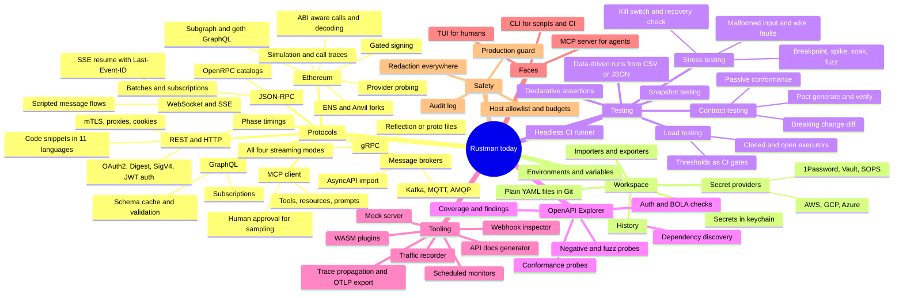

**Planned** (follow-ups):

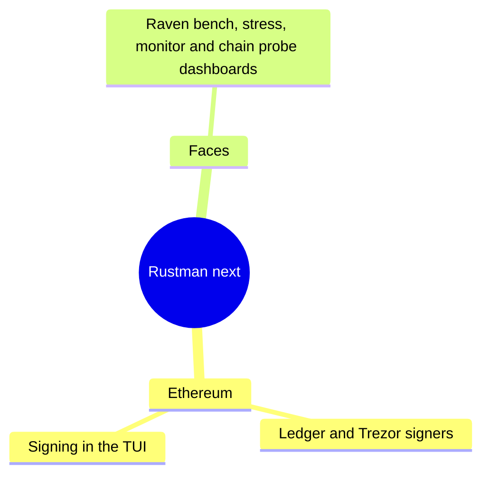

---

## What you can do with Rustman

### 1. Explore and debug APIs in a terminal UI

Open a workspace, then pick a request from the collection tree, edit it, and send it with `Ctrl+Enter`. Sends never freeze the UI, and `Esc` cancels one that's in flight. Responses open as a collapsible JSON tree with a JSONPath filter. You also get a timing waterfall (DNS, connect, TLS, time to first byte, download) and a latency sparkline built from that request's history.

```bash
rustman            # open the TUI in the current workspace
```

<p align="center">
  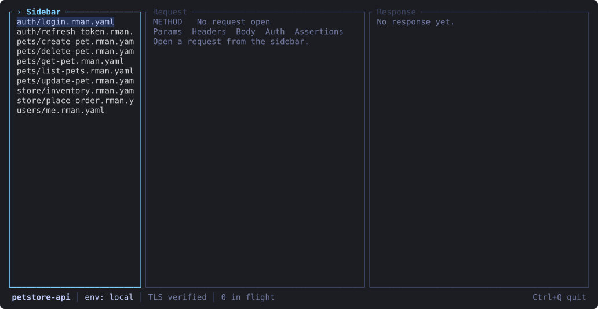
  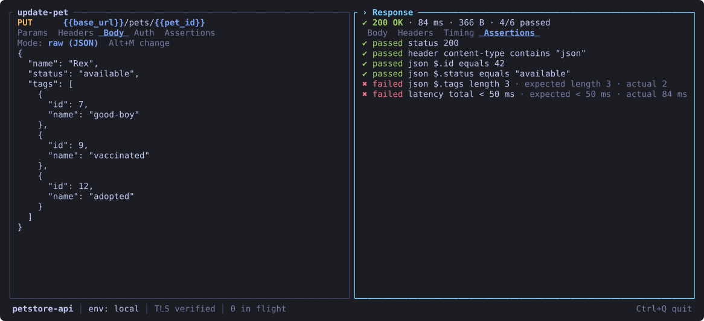
</p>
<p align="center">
  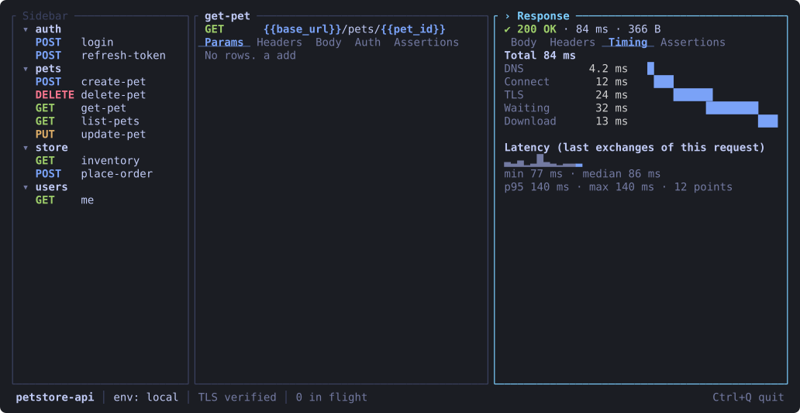
  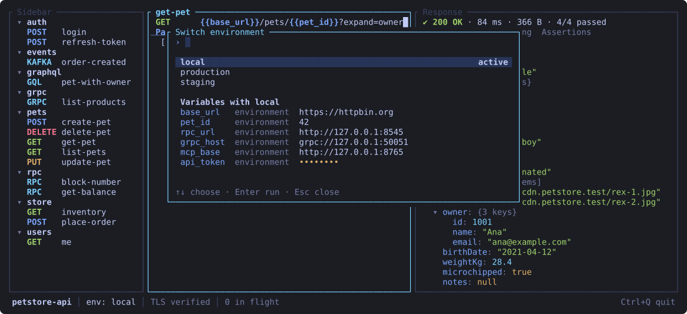
</p>
<p align="center">
  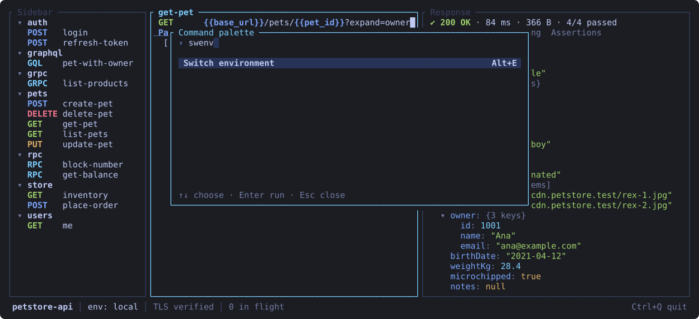
  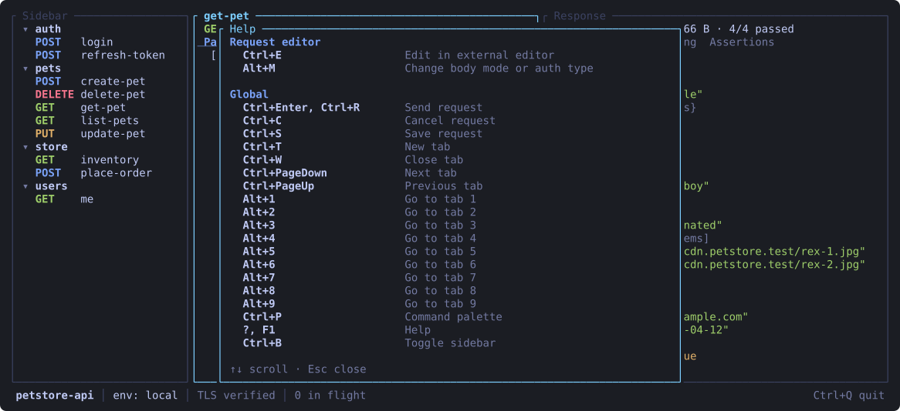
</p>

<sub>An open request with its headers and its response as a JSON tree, failed assertions with expected and actual values, the timing waterfall and latency sparkline next to a masked bearer token, the environment switcher, the command palette and help. The frames are drawn by the TUI's own renderer, but the responses shown are sample data: the `screenshot` example loads a JSON file as the exchange, with fixed timings and a made-up latency history, and evaluates the request's assertions against it, so no request was sent. [`crates/rustman-tui/examples/screenshots/render.sh`](crates/rustman-tui/examples/screenshots/render.sh) renders every README frame from the sample workspace next to it; see [Screenshots](docs/tui.md#screenshots).</sub>

| Key | Action |
|---|---|
| `Ctrl+Enter` / `Ctrl+R` | Send request |
| `Esc` / `Ctrl+C` | Cancel the request in flight |
| `Ctrl+S` | Save request file |
| `Ctrl+P` | Fuzzy command palette |
| `Ctrl+B` | Toggle sidebar |
| `Ctrl+T` / `Ctrl+W` | New tab / close tab |
| `Alt+E` | Switch environment |
| `Alt+R` | Reveal secrets (session only, shows a `SECRETS VISIBLE` badge) |
| `Ctrl+E` | Edit body in `$EDITOR` |
| `Alt+C` | Copy the request as code (curl, Python, Go...) |
| `Alt+I` / `Alt+W` / `Alt+O` / `Alt+P` | MCP inspector / webhook inspector / mock server pane / traffic recorder pane |
| `v` | Open the current response in the visual companion, if installed (else `H` exports an HTML report) |
| `?` | Help |
| `Ctrl+Q` | Quit |

There's an optional **vim mode** (`rustman tui --vim` or `keymap = "vim"` in `tui.toml`), and you can remap any key in `~/.config/rustman/keybindings.toml`. Themes: dark, light and high-contrast. Truecolor falls back to 256 colors, and `NO_COLOR` is respected. The layout adapts down to 80x24.

### 2. Keep your API collections in Git

A workspace is a folder with a `rustman.toml` file. Each request is one readable YAML file:

```yaml
# users/create-user.rman.yaml
version: 1
kind: http
name: Create user
method: POST
url: "{{base_url}}/users"
headers:
  - { name: Authorization, value: "Bearer {{token}}" }
body:
  type: json
  content: { name: "Ana", role: "admin" }
assertions:
  - status: 201
  - json: { path: "$.id", exists: true }
  - latency: { total_lt: 500 }
captures:
  - { var: user_id, from: json, path: "$.id" }
```

- **Environments** live in `environments/<name>.yaml`. Variables resolve at send time, plus dynamic values such as `{{$uuid}}`, `{{$timestamp}}` and `{{$randomInt}}`.
- **Secrets** stay in your OS keychain, or in a git-ignored `.rustman/secrets.yaml`. They're never written to request files, history, reports or logs, and they're redacted wherever they could leak.
- Saving a file you didn't change produces no diff, so code review stays clean.

### 3. Run API tests in CI

```bash
rustman run . --env staging --reporter pretty --reporter junit:out/junit.xml
rustman send users/create-user.rman.yaml --var name=Bob
rustman run api/users --data users.csv --data-label email   # one iteration per row, like newman -d
rustman import curl < request.sh          # turn a curl command into a request file
rustman export curl users/create-user     # and back
rustman export snippet --lang python-requests users/create-user   # or go, js-fetch, httpie, powershell...
```

Data-driven runs give each row's columns to the requests as variables. Captures reset between rows, so each iteration is independent, and JUnit test names carry the row label. Columns such as `password` or `token` are redacted automatically.

Auth helpers cover basic, bearer, API key, OAuth2 (client credentials and authorization code with PKCE), **Digest**, **AWS SigV4** and **JWT** (a fresh signed token per request):

```yaml
auth: {type: aws_sigv4, region: eu-west-1, service: execute-api, from: env}
```

Exit codes are stable across every command, so they're easy to script against:

| Code | Meaning |
|---|---|
| `0` | Everything passed |
| `1` | A check failed (an assertion, or a finding at or above `--fail-on`) |
| `2` | Usage or configuration error |
| `3` | A request errored (network, TLS, timeout, unresolved variable) |
| `4` | Refused by the safety policy |
| `130` | Interrupted |

### 4. Let Rustman test your backend from an OpenAPI spec

Give Rustman an OpenAPI 3.0/3.1 document and a target. It works out how your endpoints depend on each other (for example, `POST /users` returns an id that `GET /users/{id}` needs). It then generates probes and runs them:

| Probe family | What it checks |
|---|---|
| Conformance | Status codes and response bodies match the spec's schemas |
| Negative input | Missing required fields, wrong types, values outside the allowed range or enum, oversized payloads |
| Auth enforcement | Missing or invalid credentials get `401`/`403` |
| BOLA / IDOR | With two identities, user A can't read user B's resources |
| Undocumented behavior | Status codes and methods the spec doesn't declare |
| Error leakage | Stack traces, SQL errors, missing security headers |
| Lifecycle chains | Create, read, update, delete flows, cleaning up afterwards |
| Fuzzing | Property-based inputs with a reproducible seed |

```bash
rustman import openapi https://api.example.com/openapi.json      # generate a collection
rustman explore plan --spec api.yaml --target https://staging.example.com   # dry run: list the probes
rustman explore run  --spec api.yaml --target https://staging.example.com \
  --report html=out/report.html --report sarif=out/report.sarif
rustman explore export <id> --findings all --into regressions/  # turn findings into request files
rustman report diff old.json new.json                           # what got better or worse
```

**Safe by default.** Explorations are **read-only** (`GET`, `HEAD`, `OPTIONS`) unless you pass `--allow-mutations`. `DELETE` also needs `--allow-destructive`. Only the target host is contacted, at a default of 10 req/s with probe and time budgets. A production target only runs if you repeat its host name, and `DELETE` is never allowed against production.

Each run produces findings with a severity (critical to info), the exact exchange as evidence, a curl command to reproduce it, and a coverage matrix of operations × status codes.

### 5. Query and explore GraphQL APIs

```bash
rustman graphql introspect https://api.example.com/graphql --out schema.graphql
rustman graphql query users.rman.yaml --var limit=10
```

Rustman caches the schema, validates each operation against it before sending (with exact error locations), and gives the TUI autocompletion and a schema browser. Subscriptions work over `graphql-transport-ws`, the legacy `subscriptions-transport-ws`, or SSE. File uploads, automatic persisted queries, and responses with partial data plus errors are all handled. See [`docs/graphql.md`](docs/graphql.md).

<p align="center">
  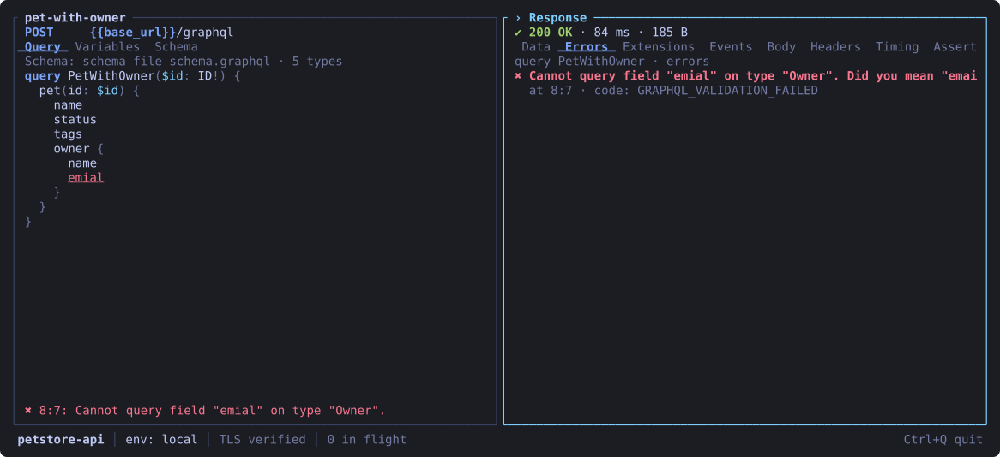
  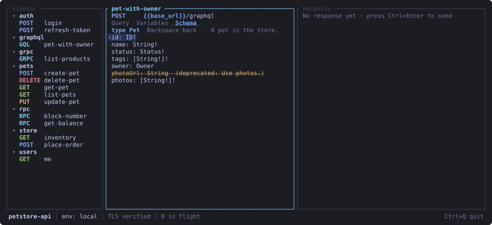
</p>

### 6. Inspect and test MCP servers

Connect to any Model Context Protocol server over stdio or Streamable HTTP. Older HTTP+SSE servers are handled too:

```bash
rustman mcp-client tools files
rustman mcp-client call files read --arg path=README.md
rustman mcp-client resources files --read file:///notes.md
```

Servers are defined in `rustman.toml` (`[mcp_servers.<name>]`) or `mcp/servers/<name>.yaml`; `stdio:<command line>` and `http(s)://` URLs work ad hoc. Spawning a stdio server needs **workspace trust**: Rustman shows the full command line and runs nothing until you approve it (headless commands need `--trust`).

You get forms generated from each tool's input schema, output validation, a stream of server notifications, progress and cancellation, and OAuth 2.1 for remote servers. If a server asks the client to run an LLM prompt (sampling) or to ask the user something (elicitation), Rustman **always asks you first**, and headless runs refuse. You can save tool calls as `kind: mcp` request files with assertions and replay them in CI. In the TUI, `Alt+I` opens the MCP inspector. See [`docs/mcp-client.md`](docs/mcp-client.md).

<p align="center">
  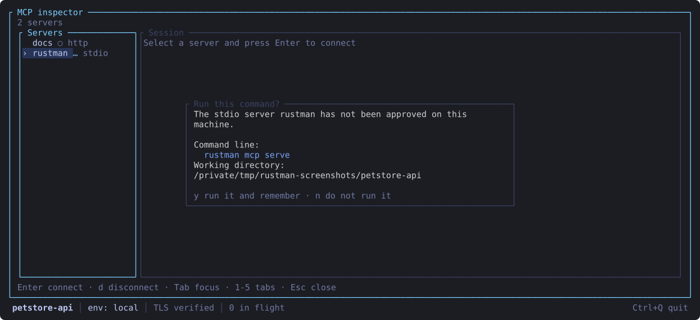
</p>

### 7. Give your AI agent an API workbench

Rustman runs as an MCP server, so agents such as Claude Code can list requests, send them, run collections, import OpenAPI specs and run explorations. They use the same engine and the same safety rules as a human:

```bash
claude mcp add rustman -- rustman mcp serve      # stdio
rustman mcp serve --http 127.0.0.1:8765          # Streamable HTTP (bearer token required)
```

```toml
# rustman.toml — agent permissions come only from this file, never from CLI flags
[agent]
allow_mutations = false        # read-only by default
allow_destructive = false
require_confirmation = true    # a human approves every change through MCP elicitation
allowed_hosts = ["https://staging.example.com"]   # origins; empty: the active environment's
```

Tool results are size-capped, paginated and redacted. Every agent action is written to an append-only audit log in `.rustman/audit/`. Long explorations run as background jobs that report progress and can be cancelled. See [`docs/agent.md`](docs/agent.md).

### 8. Catch and replay webhooks locally

```bash
rustman webhook listen                 # 127.0.0.1:9090 by default
rustman webhook listen --jsonl | jq -c '{path, signature}'   # one JSON object per event
```

The listener accepts any method on any path and stores bodies byte for byte. You can set mock responses per path in `webhook/mocks.yaml` (status, headers, body, delay) and verify GitHub, Stripe or generic HMAC signatures. In the TUI's webhook pane (`Alt+W`) you browse the captures, replay one to another URL with transport headers stripped so the replay is clean, save it as a request file or copy it as curl. Size limits and a bounded buffer keep memory in check. See [`docs/webhooks.md`](docs/webhooks.md).

### 9. See it visually when the terminal isn't enough

_Side track. The companion and the Rustman side are built. Prebuilt `rustman-viz` packages are not published yet: [build it from source](docs/viz.md#installing) with the Raven library._

With the optional **`rustman-viz`** companion, built on the [Raven](https://github.com/oscar-soirey/Raven) GUI library, run, exploration and load-test (`rustman bench`) results open as native dashboards:

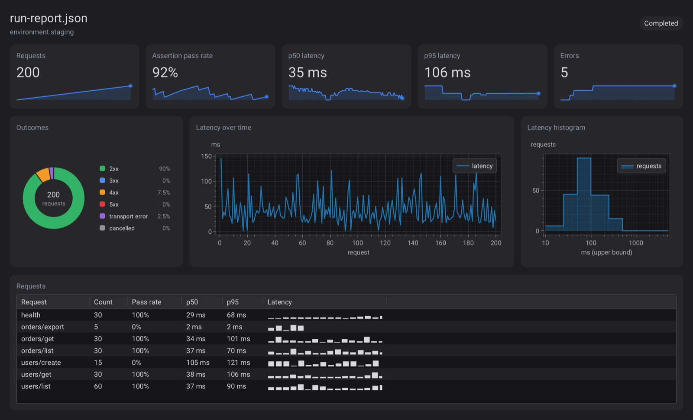

- **Run dashboard:** KPI tiles with sparklines, a donut of outcomes, latency over time and a histogram, per-request trends
- **Exploration dashboard:** a heatmap of operations × status classes (click a row to filter the findings), coverage gauges, findings by severity
- **API graph:** the operations and the values they pass to each other, coloured by their worst finding
- **Large responses:** JSON arrays as sortable tables with virtual rows, plus a read-only JSON view

| Exploration dashboard | API graph |
|---|---|
| 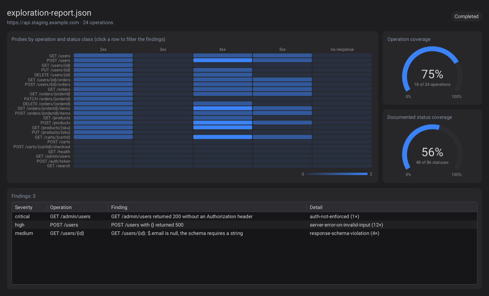 | 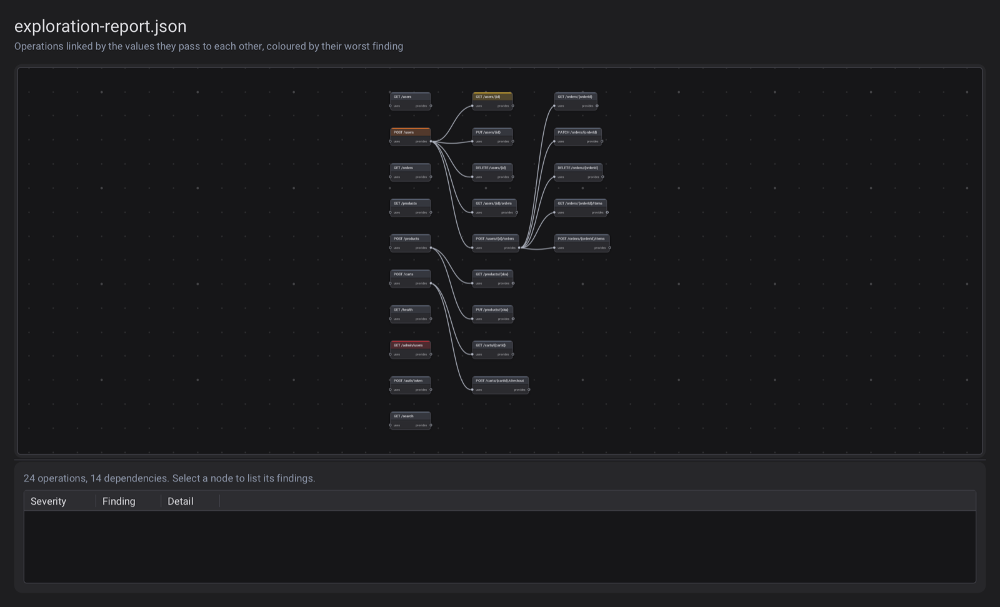 |

```bash
rustman run api/ --viz                 # stream a live dashboard while the run executes
rustman explore run --spec api.yaml --target https://staging.example.com --viz
rustman viz reports/run.json           # open a saved report (--view graph for an exploration's API graph)
```

In the TUI, `v` opens the current response in the inspector. The companion is **optional and read-only**: it never sends requests, and it gets only redacted data. It draws with Metal on macOS and Vulkan on Linux and Windows. It is built separately (cargo feature `raven`, in a workspace of its own), so `rustman` never needs it. When it isn't installed, or graphics can't start, Rustman says why and offers the self-contained HTML report instead. See [`docs/viz.md`](docs/viz.md). The screenshots show sample data.

### 10. Work with Ethereum and other JSON-RPC chains

Any JSON-RPC 2.0 API works (Ethereum, Bitcoin Core, Solana, Starknet), over HTTP or WebSocket, with batches, subscriptions and OpenRPC method catalogs that check params before anything is sent and drive completion in the TUI. Values are never decoded, so `"0x10"` stays `0x10`. See [`docs/jsonrpc.md`](docs/jsonrpc.md).

```bash
rustman rpc call {{rpc_url}} eth_blockNumber
rustman rpc call {{rpc_url}} eth_getBalance '["0xd8dA6BF26964aF9D7eEd9e03E53415D37aA96045", "latest"]'
rustman rpc call rpc/get-balance.rman.yaml           # a kind: jsonrpc request file
rustman rpc batch {{rpc_url}} calls.json             # up to 100 calls in one batch
rustman rpc discover {{rpc_url}}                     # cache the node's OpenRPC catalog
```

<p align="center">
  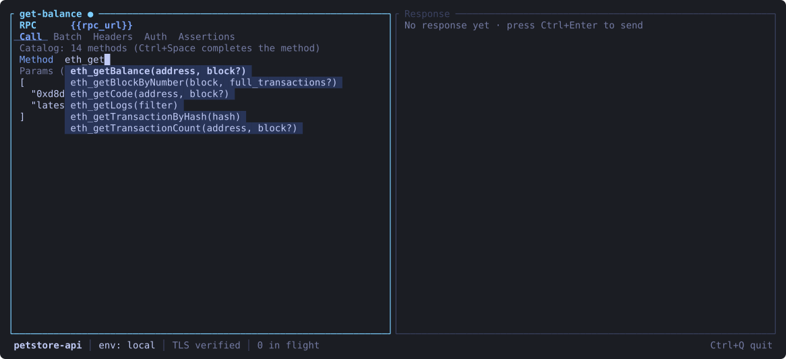
</p>

**EVM toolkit.** For EVM chains, Rustman adds a console that understands ABIs, built on `alloy`. Every node call goes through the JSON-RPC client, so its transport settings, method guards and redaction apply. See [`docs/evm.md`](docs/evm.md).

```yaml
# rpc/usdc-balance.rman.yaml
version: 1
kind: evm-call
name: USDC balance
rpc: "{{rpc}}"
to: "0xA0b86991c6218b36c1d19D4a2e9Eb0cE3606eB48"
abi: erc20
function: balanceOf
args: ["0xd8dA6BF26964aF9D7eEd9e03E53415D37aA96045"]
assertions:
  - evm: {output: balance, gte: "250 USDC"}
```

```bash
rustman evm call rpc/usdc-balance.rman.yaml --env mainnet   # balance = 250.00 USDC (250000000)
rustman evm call --to 0xA0b8… --abi erc20 --function balanceOf vitalik.eth
rustman evm call vault.rman.yaml --estimate --trace   # gas estimate and simulated call tree, when the node supports it
rustman evm decode --abi erc20 0xa9059cbb…             # offline: transfer(to=0xd8dA…, amount=10)
rustman evm tx 0xdeed… --env mainnet                   # decoded transaction, receipt and logs
rustman evm logs --address 0xA0b8… --event "Transfer(address,address,uint256)" --max-events 5
rustman evm ens vitalik.eth --env mainnet
rustman evm fork --chain mainnet --block 20000000      # local Anvil fork with a temporary fork-<chain> environment
```

- **Chain pinning.** An environment pins `chain_id`, and Rustman refuses to call a node that reports a different chain (exit code 4). The node client (geth, reth, erigon, Anvil...) is detected and shown.
- **Decodes everything:** calls, outputs, logs, transactions and receipts, `Error(string)`, `Panic` codes and custom errors. ERC-20/721/1155 ABIs are built in; Foundry and Hardhat artifacts and JSON ABIs load from the workspace, and verified ABIs can be fetched from an explorer (off by default). Token amounts are shown in token units with the raw integer.
- **Simulation:** `eth_call` at any block with state overrides, gas estimates, and call traces (`debug_traceCall` or `trace_call`).
- **Assertions and captures on decoded values**, in the output's own units: `gte: "250 USDC"`, "event emitted", "reverts with".
- **Streams:** new heads and logs over WebSocket, with HTTP polling as a fallback and reorged logs marked.
- **TUI and agents:** `evm-call` files open in an EVM pane (function picker, typed arguments, block, decoded result, trace and events). `rustman mcp serve` adds six read-only EVM tools, with log queries capped at 10,000 blocks.

<p align="center">
  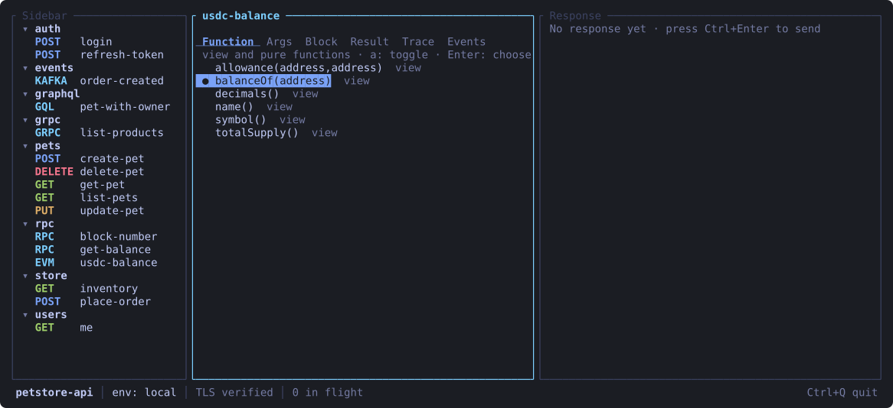
</p>

**Probing providers.** `rustman evm probe` checks one or more RPC providers, read-only and under the safety policy (host allowlist, rate, concurrency and a request budget per provider): which methods each one supports, archive or full node, latency per method, `newHeads` and log subscriptions, and, with two or more, head drift and whether they agree on a block hash and state at a fixed block. The result is an exploration report in every report format, with `--fail-on`. API keys typed into a URL are redacted. See [`docs/evm-probe.md`](docs/evm-probe.md).

```bash
rustman evm probe https://rpc-a.example https://rpc-b.example --report html=probe.html
rustman evm probe mainnet-a --methods all --rate-discovery --max-rate 20
```

**Blockchain GraphQL.** GraphQL requests get presets for geth's EIP-1767 endpoint and The Graph subgraphs, detected from the schema or set with `preset:`. Values are formatted only for display (exact `BigInt` decimals, hex, token units, checksummed addresses), while assertions compare the raw values. Subgraph lists can be paged, and a subgraph's lag behind the chain head is checked. See [`docs/evm.md`](docs/evm.md#blockchain-graphql-presets).

```yaml
# subgraph/transfers.rman.yaml
version: 1
kind: graphql
name: Transfers
endpoint: "{{subgraph}}"
preset: subgraph
document: |
  query Transfers($last: ID) {
    transfers(first: 1000, where: {id_gt: $last}) { id from to value transactionHash }
  }
assertions:
  - subgraph: {max_lag_blocks: 50}
```

```bash
rustman graphql query subgraph/transfers.rman.yaml --paginate --max-pages 50   # follows id_gt and joins the pages
rustman graphql query subgraph/transfers.rman.yaml --raw                       # values as the server sent them
```

**Signing.** `kind: evm-tx` requests are the only way Rustman signs or sends a transaction, from the command line. See [`docs/evm-signing.md`](docs/evm-signing.md).

```bash
rustman evm signer import ci                            # a key into the OS keychain (no-echo prompt)
rustman evm send transfer.rman.yaml --env sepolia       # decoded preview only: refuses without --sign
rustman evm send transfer.rman.yaml --env sepolia --sign
rustman run . --env anvil --sign --yes-local            # CI on a local Anvil chain, no prompt
```

> [!IMPORTANT]
> **Signing is locked by default.** It needs `[evm] allow_signing = true` in `rustman.toml`, `--sign`, a keystore or OS-keychain signer (raw private keys and seed phrases are refused everywhere), and an environment whose `chain_id` matches the node. Every transaction is simulated, then shown decoded for you to confirm; mainnet and `protected_chains` also need the chain name typed, and `--yes-local` works only on local chains (31337 or `headless_signing_chains`) up to `[evm] max_cost`. Every sent transaction gets an audit record. **AI agents can never sign:** the agent server doesn't link the signing crate, and send methods are refused in `jsonrpc` files, EVM calls and JSON-RPC bodies of `http` requests. Ledger and Trezor signers ([#111](https://github.com/CyberdyneCorp/rustman/issues/111)) and signing from the TUI ([#112](https://github.com/CyberdyneCorp/rustman/issues/112)) come later.

### 11. Migrate from other tools in one command

```bash
rustman import postman collection.json --into api/
rustman import insomnia export.yaml
rustman import bruno ./my-bruno-collection
rustman import har session.har          # static assets are dropped by default
rustman import requests.http            # JetBrains / VS Code REST Client format
rustman export postman api/ -o out.json
```

Variables are translated to `{{var}}`. **Secrets found in the source go to the secret store, never into request files.** **Postman scripts aren't run.** Rustman has no scripting language by design. Instead, the importer converts common `pm.test` statements into declarative assertions and captures: status, response time, body text, header values, `pm.response.json()` field checks, and `pm.environment.set` / `pm.collectionVariables.set`. It prints how many statements it converted (for example `scripts: 31/40 statements converted (77%)`). The rest stay in the file as comments.

```bash
rustman import postman collection.json --into api/ --migration-report migration.md
```

The migration report lists every statement it couldn't convert, with a suggested equivalent (a schema assertion, collection ordering, or a plugin). See the [Postman migration guide](docs/migrate-from-postman.md) for the whole process.

### 12. Mock an API before it exists

```bash
rustman mock serve api.yaml --port 4010
```

Responses come from your OpenAPI spec: named examples, or data synthesized from the schema with a fixed seed. Requests are validated against the spec. A `Prefer: code=404` header selects a response, compatible with Prism. Hand-written overrides can add delays, error rates or dropped connections. **Stateful mode** keeps created resources in memory, so `POST` then `GET` works. The server reloads when files change.

### 13. Snapshot-test responses

Add a `snapshot` assertion. The first run records a normalized response next to the request file, and later runs show a structural diff when it changes. Timestamps, UUIDs and fields you choose are ignored, and secrets are redacted before anything is stored. In CI (`--ci` or `CI=true`) a missing snapshot is a failure instead of being written. In the TUI, `a` approves a change and `r` rejects it.

```bash
rustman run . --update-snapshots
rustman snapshot prune --yes
```

### 14. gRPC, WebSocket, SSE and message brokers

**gRPC** works today:

```bash
rustman grpc list grpc://localhost:50051             # via server reflection or .proto files (no protoc needed)
rustman grpc describe grpc://localhost:50051 shop.v1.Catalog/ListProducts   # call type, types, request template
rustman grpc call grpc/get-product.rman.yaml
rustman grpc call --target grpc://localhost:50051 --method shop.v1.Catalog/ListProducts --data '{}' --json
rustman grpc health grpc://localhost:50051 --service shop.v1.Catalog          # exit 0 SERVING, 1 NOT_SERVING
```

`kind: grpc` request files need no generated code: schemas come from server reflection (v1, v1alpha fallback, cached for offline browsing), `.proto` files compiled in-process or descriptor sets. You get all four call types with a message timeline, deadlines, binary metadata, TLS/mTLS/h2c and gRPC-Web, decoded `google.rpc.Status` details, `grpc_status` and `metadata` assertions, `kind: grpc` in `rustman run` alongside HTTP, and a health-check helper. See [`docs/grpc.md`](docs/grpc.md).

<p align="center">
  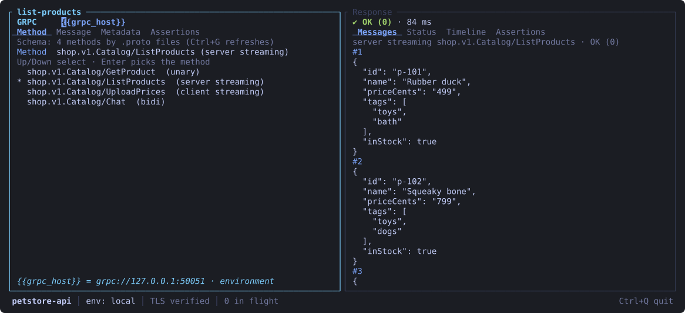
  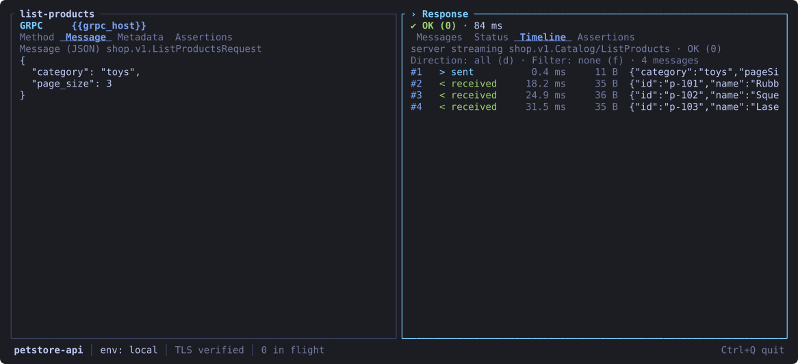
</p>

<sub>The gRPC response is a sample call record loaded by the `screenshot` example; no server was called.</sub>

**WebSocket and SSE:** scripted send / wait-for / assert steps, and SSE resume with `Last-Event-ID`. See [`docs/realtime.md`](docs/realtime.md).

```bash
rustman ws connect wss://echo.example.com --json
rustman sse listen https://api.example.com/events --json --max-messages 3
```

**Message brokers:** Kafka, MQTT and AMQP, in pure Rust (no C libraries).

```bash
rustman kafka consume --brokers localhost:9092 --topic orders --offset earliest --max-messages 5 --json
rustman kafka produce --brokers localhost:9092 --topic orders --key order-1 --value '{"id":1}'
rustman mqtt consume --broker mqtt://localhost --topic 'sensors/+/temp'
rustman amqp produce --broker amqp://localhost --exchange orders --routing-key order.created --mandatory --value hi
rustman import asyncapi asyncapi.yaml        # AsyncAPI 2.6 / 3.0 into request files and environments
```

`kind: kafka`, `kind: mqtt` and `kind: amqp` request files produce or consume, and run in `rustman run` next to HTTP with assertions (`messages: {count_eq: 1}`, JSONPath on decoded values), captures and history. Kafka has partitions, keys, offsets by position or timestamp, SASL PLAIN/SCRAM and a Schema Registry; MQTT v3.1.1 and v5 with QoS 0–2, retain, TLS and WebSocket; AMQP properties, publisher confirms and temporary or named queues. Headless consumes are bounded by count, bytes and time, and payloads can be validated against an AsyncAPI schema. Producing is a mutation under the safety policy, consuming from a named queue counts as destructive, and broker credentials never reach history, reports or agents. In the TUI, a messaging request opens in its own editor with a live message timeline. See [`docs/messaging.md`](docs/messaging.md).

<p align="center">
  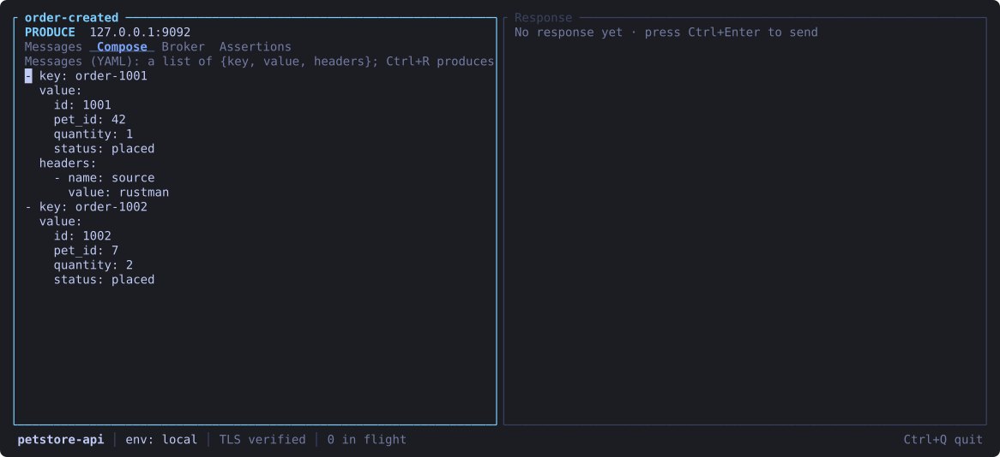
</p>

### 15. Record real traffic into request files

```bash
rustman record --save --har session.har                 # forward proxy on 127.0.0.1:8888
rustman record --intercept "*.example.com" --save       # decrypt HTTPS for these hosts only
rustman record --upstream https://api.example.com --port 9000   # reverse proxy, for clients that can't use a proxy
rustman record ca init && rustman record ca install      # the workspace's local CA, trusted only when you say so
```

Point an app or CLI at the proxy (it prints the `HTTP_PROXY`/`HTTPS_PROXY` lines to export) and Rustman captures its HTTP/1.1 and HTTP/2 traffic. When you stop, `--save` writes request files through the importer pipeline: ids become variables (`/users/{{user_id}}`), similar requests are deduplicated into one file per method and path, the base URL moves into an environment, and tokens, cookies and API keys become secret placeholders whose values are never written to files. `--har` exports a HAR file readable by you only. HTTPS is decrypted only for hosts in `--intercept`, with a per-workspace CA whose private key lives only in the OS keychain; installing it in a trust store takes an explicit `rustman record ca install`, and every other host is an opaque tunnel. The proxy binds loopback unless you pass `--allow-remote`, and even then network clients can't reach private addresses through it. In the TUI, `Alt+P` opens the recorder pane to start the proxy, follow captures live, replay and save them. See [`docs/record.md`](docs/record.md).

### 16. Load-test with the requests you already have

```bash
rustman bench api/ --target https://staging.example.com --vus 20 --duration 1m
rustman bench api/ --target https://staging.example.com --executor ramping-vus --stage 30s:20 --stage 1m:20 --stage 30s:0
rustman bench api/ --target https://staging.example.com --executor constant-arrival-rate --rate 50 --max-vus 20 \
  --threshold "p95<300ms" --threshold "error_rate<1%" --report html=out/bench.html
```

You can run a fixed number of virtual users (`constant-vus`), ramp them in stages (`ramping-vus`), or hold a constant arrival rate (`constant-arrival-rate`). Each VU has its own variables, captures and cookies, and `--data` feeds rows from a CSV or JSON file. In the open model, latency counts from each iteration's scheduled start, so queuing in a server that falls behind shows up in the percentiles. Thresholds such as `p95<300ms` make the command exit with 1 when breached (a trailing `!` stops the bench at once), and reports come as JSON, HTML, Markdown, JUnit or SARIF. On a terminal a live dashboard shows progress; in CI, one line every 10 seconds. `--viz` streams per-second metrics to the viz companion's bench dashboard, and `rustman viz` opens a saved bench report there. Load tests are capped by default (50 VUs, 5 minutes, 200 rps; only `rustman.toml [bench]` raises them), stay on the single `--target` origin, need `--allow-mutations` for writes, and AI agents can't start them. See [`docs/bench.md`](docs/bench.md).

### 17. Find where your backend breaks

```bash
rustman stress breakpoint api/catalog --target https://staging.example.com \
  --slo "p95<300ms" --slo "error_rate<1%" --require-rps 100 --report html=out/stress.html
rustman stress spike api/ --target https://staging.example.com --baseline-rps 20 --spike-factor 10
rustman stress soak api/ --target https://staging.example.com --rps 50 --duration 2h
rustman stress fuzz api/orders --target https://staging.example.com --rps 20 --allow-mutations \
  --malformed json-syntax,deep-nesting --seed 42
rustman stress export str-20261120-3fa9c1 --findings all --into regressions/stress
```

Load tests check the load you choose. Stress runs **search for the limit**:

- **Breakpoint:** the request rate climbs in steps until an SLO breaks in two consecutive 5-second windows, then bisects to narrow down the limit. The report gives the highest rate that held (`max_sustainable_rps`), the rate that broke, how it broke (latency, server errors, timeouts, connection errors, saturation), and which endpoint failed first. A `429` from your rate limiter is reported as "rate limited", not as broken.
- **Spike:** a baseline, a sudden jump (10x by default), then the baseline again, measuring errors during the spike and how long the service takes to recover.
- **Soak:** hours of steady load, flagging latency or error drift that hints at a leak.
- **Fuzz, or bad data under any mode:** `--fuzz-ratio` swaps a share of real requests for mutated ones (or, with `--spec`, ones that break one schema constraint), measured apart from valid traffic and compared against a clean baseline, so you see whether bad clients slow down good ones.
- **Malformed input:** broken JSON, 10 000-deep nesting, huge or very wide bodies, invalid UTF-8, duplicate keys, extreme numbers, and opt-in compression bombs.
- **HTTP framing faults** (`--wire`, needs `--allow-wire-faults`): conflicting `Content-Length`/`Transfer-Encoding`, invalid chunked encoding, oversized headers and slow clients, sent as raw HTTP/1.1 after the load.

Every crash-like finding is shrunk to a minimal input that still triggers it, and `rustman stress export` writes it as a regression request for `rustman run`. Runs are seeded, so `--seed` reproduces the exact inputs. `--require-rps 100` turns a capacity target into a CI gate. Every report is kept under `.rustman/stress/<id>/`, and `--report` also writes JSON, HTML, Markdown, JUnit or SARIF. See [`docs/stress.md`](docs/stress.md).

> **Only stress systems you own or are authorized to test.** Stress targets must be listed in `rustman.toml [stress] targets`; no CLI flag can add one. Production needs a second opt-in (`[stress] allow_production` and `--production`), and fuzzing, malformed input and wire faults are never sent to production. A kill switch stops the load the moment the target stops answering, then a recovery check confirms it comes back. AI agents can't start stress runs.

### 18. Catch breaking API changes before they merge

```bash
rustman contract diff old.yaml new.yaml                  # exit 1 on a breaking change
rustman contract diff --base origin/main openapi.yaml --report markdown=out/contract.md   # for a PR comment
rustman contract pact generate api/ --consumer web --provider users   # contracts/pacts/web-users.json
rustman contract pact verify contracts/pacts/web-users.json --provider-url http://localhost:8080
rustman contract verify --spec openapi.yaml --since 7d    # check recorded traffic, sends nothing
```

Changes are classified as breaking, non-breaking or unknown using a versioned [rule catalog](docs/contract-rules.md) (`rustman contract rules` lists it). Request and response schemas follow opposite rules, so a stricter request is breaking while a response that adds fields is not. Accepted changes go in `contracts/allowlist.yaml`, each with a justification and an optional expiry. Pact v3/v4 contracts are generated from a collection's requests and assertions, with secrets redacted, and verified against a provider under the safety policy. `rustman contract verify` checks history or a run report against the spec and opens no network connection. See [`docs/contract.md`](docs/contract.md).

### 19. Generate API docs from your collections

```bash
rustman docs build --out site/      # self-contained offline HTML; --format markdown or both
rustman docs serve                  # preview on 127.0.0.1:4000 with live reload
```

Docs include request tables, OpenAPI descriptions, code samples (curl, httpie, fetch, Python, Rust, or any `rustman export snippet` language), GraphQL schema and JSON-RPC method references, and client-side search. Real examples appear only for requests that opt in, are always redacted, and the build fails if a secret would leak. The output is deterministic, so it diffs cleanly in Git and publishes as is to GitHub Pages. See [`docs/api-docs.md`](docs/api-docs.md).

### 20. Monitor your APIs on a schedule

```yaml
# monitors/api-health.rman-monitor.yaml
version: 1
name: api-health
targets: [health/]
environment: prod
schedule: { every: 5m }          # or { cron: "*/5 * * * *", tz: UTC }
alerts:
  rules:
    - consecutive_failures: 3
    - latency_p95_gt: 800
  notify:
    - desktop: true
    - webhook: { url: "{{slack_hook}}", template: slack }   # a secret of the environment
```

```bash
rustman monitor run api-health                          # one run, for cron or CI
rustman monitor daemon                                  # long-running local scheduler
rustman monitor schedule-recipe api-health --for cron   # or systemd, launchd, github-actions
rustman monitor status                                  # last outcome, uptime, p95 sparkline, firing rules
```

Monitors run your collections through the normal run engine and keep a git-ignored history under `.rustman/monitors/` (30 days). Alert rules cover consecutive failures, failures in a window, p95 latency, failed assertions and unexpected status codes. Alerts go to desktop notifications, Slack, Discord or generic webhooks, or email (with the `smtp` feature); they're deduplicated, have a cooldown, and send a notice when things recover. Monitors are read-only by default: POST, PUT and PATCH need `allow_mutations: true`, and DELETE is never sent. In the TUI, **Monitors** in the command palette lists each monitor's last outcome, uptime and latency trend, and runs one on demand. See [`docs/monitors.md`](docs/monitors.md).

<p align="center">
  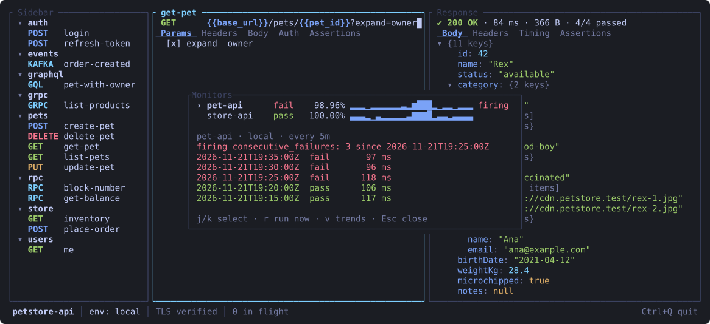
</p>

<sub>The monitor results are sample data written into the store by the screenshot script; no request was sent.</sub>

### 21. Follow a request into your backend traces

```yaml
# environments/staging.yaml
trace:
  enabled: true
  formats: [w3c, b3multi]
  link: jaeger
  link_base: http://localhost:16686
```

```bash
rustman send users/get-user --trace      # prints the trace id and link on stderr
rustman trace open 01JD3W6Q              # open a history exchange's trace (id or unique prefix)
```

Turn on trace propagation (`trace:` in an environment, `[trace]` in `rustman.toml`, or `--trace`) and Rustman adds a W3C `traceparent` header (or B3) to every request, plus optional `tracestate` and `baggage`. With `scope: run`, a whole `rustman run` shares one trace. Each exchange records its trace id in history and run reports, and `rustman trace open` (or `Ctrl+O` in the TUI's Timing tab) opens it in Jaeger, Tempo, Honeycomb, Datadog or a custom link. Rustman also parses `Server-Timing` headers, and a build with the `otlp` feature can export its own client spans over OTLP to an endpoint you configure. It's off by default and stays local-first. See [`docs/tracing.md`](docs/tracing.md).

### 22. Extend it with plugins and external secret stores

```bash
rustman plugin new my-auth --kind auth     # scaffold a WASM plugin project
rustman plugin add ./my-auth               # pinned by sha256 in rustman.toml and rustman.lock
rustman plugin test ./my-auth              # run its test cases
rustman secret get vault/kv/app#password   # prints the length, never the value (--reveal on a TTY only)
rustman secret list-providers
```

- **WASM plugins** (wasmtime, a frozen `rustman:plugin@1.0.0` WIT API) add auth schemes, assertion functions, value generators (`{{$plugin.name}}`), request and response transformers, importers, request kinds with their own TUI pane, and report renderers. A plugin gets no filesystem, network, environment, clock or secrets unless the workspace grants each one in `rustman.toml` (`fs:read:<dir>`, `net:<host>`, `secrets:read:<name>`...), and each call has a time and memory limit. Plugins load only after you trust the workspace's plugin set (or `--trust-plugins` in CI), and agents can never install, grant or trust one. `plugin new` has a template for each extension point and a Rust SDK. See [`docs/plugins.md`](docs/plugins.md).
- **Secret providers:** `{{secret:vault/kv/app#password}}` resolves at send time from the OS keychain, environment variables, SOPS, 1Password, HashiCorp Vault, a command (user config only), or AWS Secrets Manager / SSM, GCP Secret Manager and Azure Key Vault (cargo features). Values are cached in memory only, never stored on disk, and redacted everywhere; exports and snippets show `«redacted:provider/path»` without contacting the provider. Agents can't pass secret references in tool arguments. See [`docs/secrets.md`](docs/secrets.md); the environment's own keychain secrets (`rustman secret set|rm|list`) are in [`docs/environments.md`](docs/environments.md).

---

## Coming from Postman?

The [migration guide](docs/migrate-from-postman.md) walks through a full move: exporting, `rustman import`, reviewing converted scripts, replacing Newman in CI, and what doesn't carry over.

| Postman / Newman | Rustman |
|---|---|
| Collections, folders, environments, globals | Folders of `*.rman.yaml` files, `_collection.yaml`, `environments/*.yaml`, `rustman.toml` defaults |
| Secret variables, Vault integration | OS keychain, plus `{{secret:...}}` from 1Password, Vault, SOPS and cloud secret managers |
| `pm.test` / pre-request scripts | Declarative assertions and captures, and sandboxed WASM plugins for custom logic. Scripts are converted on import where possible. |
| `newman run -d data.csv -r junit` | `rustman run --data data.csv --reporter junit:out.xml` |
| Auth: Basic, Bearer, API key, OAuth2, Digest, AWS SigV4, JWT | Built in |
| Auth: NTLM, Hawk, OAuth 1.0, Akamai EdgeGrid | Via auth-scheme plugins |
| Code button (snippets) | `rustman export snippet`, or `Alt+C` in the TUI |
| Mock servers, API docs | `rustman mock` and `rustman docs`, all local |
| Monitors | `rustman monitor`, run locally, by the OS scheduler or in CI |
| Performance testing | `rustman bench` for load, `rustman stress` for breaking points |
| API governance, contract tests | `rustman contract diff` for breaking changes, Pact generate and verify |
| Interceptor / proxy capture | `rustman record`, with a local CA |
| Visualizer | Raven dashboards (`rustman-viz`, optional companion) |
| GraphQL, gRPC, WebSocket, Socket.IO, MQTT | GraphQL, gRPC, JSON-RPC, WebSocket, SSE, Kafka, MQTT and AMQP. Socket.IO via plugins. |
| Team workspaces and cloud sync | Git. Rustman is local-first, with no accounts. |

**What you lose:** running arbitrary JavaScript in requests, and cloud collaboration. Both are deliberate choices.

**What you gain:**
- OpenAPI-driven exploration
- an MCP server for agents
- snapshot, contract, load and stress testing
- generated API docs and trace propagation
- traffic recording, monitors, message brokers and WASM plugins
- an Ethereum console with provider probing, subgraph helpers and a signing gate
- a single native binary

---

## Architecture

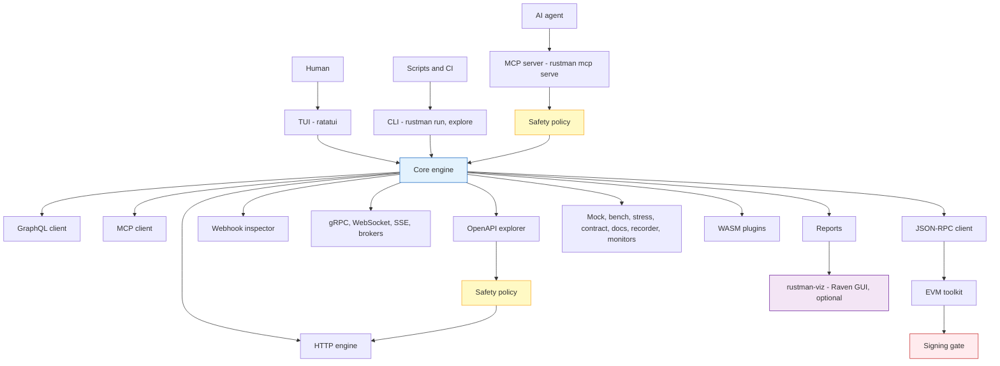

| Crate | Responsibility |
|---|---|
| `rustman-core` | Workspace, environments, variables, secrets, request model, safety policy |
| `rustman-http` | HTTP execution on hyper and rustls, timings, auth (including Digest, SigV4, JWT), curl import and export, code snippets |
| `rustman-graphql` | GraphQL execution, introspection, validation, subscriptions |
| `rustman-mcp` | MCP client and server, built on the official `rmcp` SDK |
| `rustman-explore` | OpenAPI parsing, probe generation, exploration engine, findings |
| `rustman-report` | Reports in `rustman.report/v1` format: JSON, JUnit, TAP, Markdown, HTML, SARIF |
| `rustman-webhook` | Webhook inspector, built on hyper |
| `rustman-tui` | Terminal UI |
| `rustman-cli` | The `rustman` binary |
| `rustman-viz-protocol` | Serde types of the `rustman-viz/1` protocol between the CLI or TUI and the companion |
| `rustman-viz-client` | Producer side of the viz protocol: companion discovery, protocol check, handshake and non-blocking live streaming |
| `rustman-jsonrpc` | Generic JSON-RPC 2.0 client over HTTP and WebSocket |
| `rustman-grpc` | gRPC client using tonic, reflection and protox |
| `rustman-import` | Postman, Insomnia, Bruno, HAR and `.http` import and export |
| `rustman-mock` | OpenAPI mock server |
| `rustman-viz` | Optional Raven GUI companion: a separate binary in its own workspace (`crates/rustman-viz`) |
| `rustman-evm` | Ethereum toolkit on `alloy`: chain identity, units, ABIs, decoding, simulation, traces, streams, ENS, Anvil forks, provider probing, blockchain GraphQL presets. Never signs. |
| `rustman-evm-signing` | The signing gate: keystore and keychain signers, preconditions, confirmation, send, receipt wait and audit. The agent server does not link it. |
| `rustman-realtime` | WebSocket and SSE sessions |
| `rustman-messaging` | Kafka, MQTT and AMQP clients (pure Rust: `rskafka`, `rumqttc`, `lapin`) and AsyncAPI import |
| `rustman-proxy` | Traffic recorder: forward and reverse proxy, local CA, HTTPS interception |
| `rustman-bench` | Load testing (VUs, executors, caps, HDR metrics, thresholds, bench reports) and the `stress` module (breakpoint, spike, soak and fuzz modes, malformed payloads, wire faults, kill switch, recovery, minimization) |
| `rustman-contract` | Contract testing: OpenAPI breaking-change diff with a versioned rule catalog, Pact generate and verify, passive conformance |
| `rustman-docs` | Static API docs (HTML and Markdown) generated from a workspace, with the `docs serve` preview |
| `rustman-plugin` | WASM plugin host (wasmtime): capability sandbox, pinning, workspace trust |
| `rustman-plugin-sdk` | Guest SDK for plugins: the WIT package and Rust bindings for each extension point |
| `rustman-monitor` | Scheduled monitors: schedules, the result store, alert rules, notifiers and the daemon |
| `rustman-secrets` | Secret providers behind `{{secret:...}}`: keychain, env, SOPS, 1Password, Vault, command, cloud managers |

**Build principles**
- The default binary builds with plain `cargo build`: no OpenSSL, SQLite, GPU or CMake to install.
- Linux, macOS and Windows are first-class.
- No UI code in the engine crates.
- Every bug fix ships with a regression test.

---

## Roadmap

All changes are specified in OpenSpec. v0.1 (headless core), v0.2 (usable), v0.3 (autonomous), v0.4 (multi-protocol), v0.5 (protocols), v0.6 (pro testing) and v0.7 (operate & extend) are done, as are both side tracks (the Raven companion and the EVM toolkit). v1.0 (stabilize) is in progress: every OpenSpec change is archived into the living specs in `openspec/specs/`, and the public contracts are frozen ([`docs/stability.md`](docs/stability.md)); open work is tracked in the [roadmap tracking issue](https://github.com/CyberdyneCorp/rustman/issues/46). Releases are ordered by dependency, user value and risk. The full delivery plan, with exit criteria, shared enablers and risks, is in [`ROADMAP.md`](ROADMAP.md).

| Release | Changes | You get | Status |
|---|---|---|---|
| **Phase 0** | — | Open decisions settled (license, MSRV, `rmcp` pin, YAML crate) and spec fixes | ✅ done |
| **v0.1 - Headless core** | `bootstrap-core-engine`, plus the safety policy from `add-openapi-explorer` | CLI runner with workspace, environments, secrets, HTTP engine, assertions, history | ✅ done |
| **v0.2 - Usable** (first public release) | `add-terminal-ui`, `add-importers`, `add-runner-parity` | TUI, import from Postman/Insomnia/Bruno/HAR/`.http`, data-driven runs, Digest/SigV4/JWT, code snippets | ✅ done |
| **v0.3 - Autonomous** | `add-openapi-explorer`, `add-agent-mcp-server` | OpenAPI import and exploration, HTML/SARIF reports, agent interface | ✅ done |
| **v0.4 - Multi-protocol** | `add-graphql-client`, `add-mcp-client`, `add-webhook-inspector`, `add-snapshot-testing`, `add-openapi-mock-server` | GraphQL, MCP client, webhooks, snapshot tests, mock server | ✅ done |
| **v0.5 - Protocols** | `add-jsonrpc-client`, `add-grpc-client`, `add-realtime-client` | JSON-RPC, gRPC, WebSocket and SSE | ✅ done |
| **v0.6 - Pro testing** | `add-contract-testing`, `add-trace-propagation`, `add-load-testing`, `add-docs-generator`, `add-stress-testing` | Breaking-change checks, tracing, load and stress tests, generated docs | ✅ done |
| **v0.7 - Operate & extend** | `add-secret-providers`, `add-scheduled-monitors`, `add-plugin-system`, `add-traffic-recorder`, `add-messaging-client` | Secret providers, monitors, plugins, traffic recorder, message brokers | ✅ done |
| **Side tracks** | `add-raven-visualizer`, `add-evm-toolkit` | Raven dashboards, Ethereum console (never block a release) | ✅ done |
| **v1.0 - Stable** | — | Frozen request-file, report, viz and plugin formats ([stability](docs/stability.md)); signed release artifacts; a migration guide | in progress |

The glossary, capability map and cross-cutting contracts are in [`openspec/ROADMAP.md`](openspec/ROADMAP.md).

---

## Contributing

### Developer commands with `just`

The repository has a [`justfile`](justfile) with the everyday commands, the same ones CI runs. Install [just](https://just.systems) once (`brew install just`, `cargo install just`, `winget install Casey.Just`, or your package manager), then from the repository root:

```bash
just                    # list every recipe
just build              # debug build of `rustman`
just run send GET https://httpbin.org/get    # run the CLI from source
just tui examples/demo/workspace  # open the terminal UI on a workspace
just debug send GET https://httpbin.org/get  # RUST_LOG=debug, full backtraces
just test               # workspace tests (extra args go to cargo: just test -p rustman-core)
just test-crate rustman-tui summary          # one crate, filtered
just lint               # fmt check, clippy (-D warnings), cargo-deny, OpenSpec
just ci                 # what a pull request must pass: lint + test
just release            # release build with the official features (cloud-secrets, otlp, smtp)
```

Other recipes cover the optional-feature and minimal builds (`test-features`, `test-minimal`), the EVM tests on a local Anvil (`test-anvil`), the TUI smoke tests (`test-tui`), insta snapshot review (`snapshots`), regenerating the frozen contract fixtures (`freeze`), the benchmark and fuzzers (`bench`, `fuzz sse|viz`), the plugin templates, the docs book (`docs-check`, `docs-serve`) and the viz companion (`viz`, `viz-test`). Some need an extra tool, named in `just --list`.

### Specs

Rustman is built **spec-first** with [OpenSpec](https://github.com/Fission-AI/OpenSpec):

```bash
npm install -g @fission-ai/openspec@latest
openspec list                      # changes in flight
openspec list --specs              # the living specs
openspec show cli-runner --type spec
openspec validate --all --strict   # CI runs this on every PR
```

1. Pick the next change in roadmap order, or propose a new one in `openspec/changes/<id>/`.
2. Implement it against its `tasks.md`. Each task says how to verify it.
3. Archive the change when it's done (`openspec archive <id>`). Its specs then become the living docs in `openspec/specs/`.

## License

Licensed under either of [Apache License, Version 2.0](LICENSE-APACHE) or [MIT license](LICENSE-MIT), at your option.

Unless you explicitly state otherwise, any contribution intentionally submitted for inclusion in Rustman by you, as defined in the Apache-2.0 license, shall be dual licensed as above, without any additional terms or conditions.
