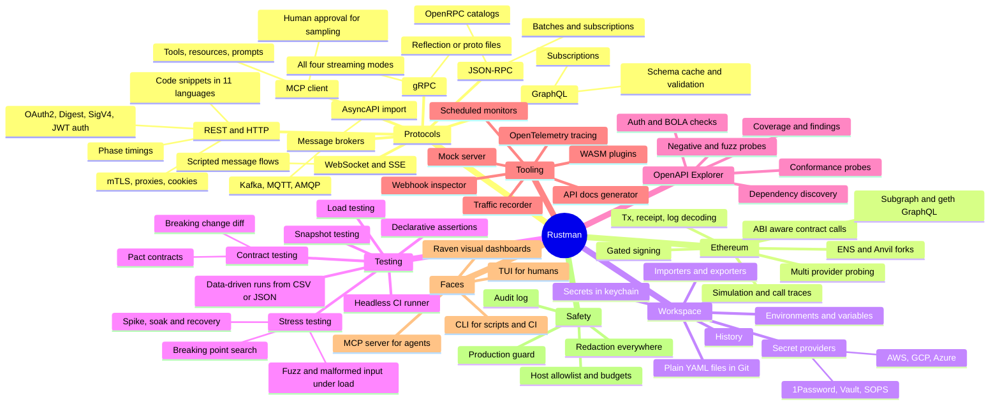
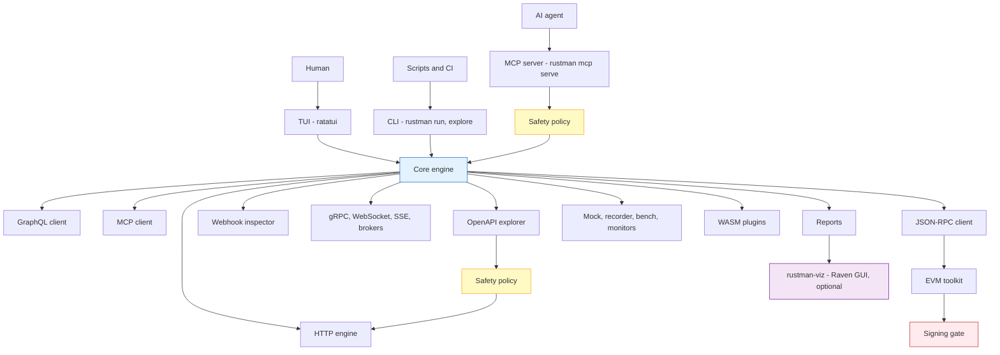

# Rustman

> A fast, local-first API workbench for the terminal. It speaks **REST, GraphQL, MCP, gRPC, WebSocket/SSE, JSON-RPC, Kafka/MQTT/AMQP and Ethereum**, it can **test a backend on its own from an OpenAPI spec**, and **AI agents can drive it over MCP**. Written entirely in Rust.

> [!NOTE]
> **Status: early development.** Rustman is fully specified, and only the project scaffold is implemented so far: the `rustman` binary builds and answers `--version` and `--help`, nothing more. Everything after the quick start below describes the planned behavior, as defined by the [OpenSpec](https://github.com/Fission-AI/OpenSpec) changes in [`openspec/`](openspec/). Commands and file formats come from those specs and may still change before v1.

## Install and quick start (current state)

There are no release binaries yet. Build from source with [rustup](https://rustup.rs); the pinned toolchain (Rust 1.97, see `rust-toolchain.toml`) is installed automatically. No system libraries are needed.

```bash
git clone https://github.com/CyberdyneCorp/rustman
cd rustman
cargo install --path crates/rustman-cli --locked
rustman --version
rustman --help
rustman init my-api        # create a workspace: rustman.toml, environments/local.yaml, a sample request
cd my-api && rustman env list   # list environments; '*' marks the active one (--env > RUSTMAN_ENV > default)
```

The request-file format is documented in [`docs/request-files.md`](docs/request-files.md). CI runs these commands on Linux, macOS and Windows for every pull request. Developer documentation lives in [`docs/`](docs/).

---

## Why Rustman?

| Pain with today's API clients | Rustman's answer |
|---|---|
| Heavy Electron apps idling at hundreds of MB of RAM | One native Rust binary that runs in your terminal |
| Mandatory accounts and cloud sync for private requests | **Local-first.** Requests are plain YAML files you commit to Git. No accounts, no telemetry. |
| One tool for REST, another for GraphQL, another for MCP | **One workbench for REST, GraphQL, MCP, gRPC, WebSocket, SSE, JSON-RPC and message brokers** |
| Blockchain RPC means raw hex in curl | **An ABI-aware Ethereum console** that decodes everything, with a signing gate that agents can never pass |
| Switching tools means rebuilding every collection | **Import from Postman, Insomnia, Bruno, HAR and `.http`**, with secrets pulled out automatically and Postman test scripts converted to assertions |
| Finding where a backend breaks means custom scripts | **`rustman stress`** finds the breaking point under load, with malformed input and recovery checks |
| Mocks, load tests, contract checks and docs each need another tool | **All built in**, and all driven from the same request files |
| Tests written by hand, endpoint by endpoint | **Point it at an OpenAPI spec** and it plans and runs a full test campaign |
| AI agents can't use your API client | **Built-in MCP server.** Agents use the same engine you do, under the same safety rules. |
| Great GUI or great automation, rarely both | **Three front-ends, one engine:** a TUI for humans, a CLI for CI, MCP for agents. An optional GUI shows charts. |

---

## Feature map



---

## What you can do with Rustman

### 1. Explore and debug APIs in a terminal UI

Open a workspace, then pick a request from the collection tree, edit it, and send it with `Ctrl+Enter`. Sends never freeze the UI, and `Esc` cancels one that's in flight. Responses open as a collapsible JSON tree with a JSONPath filter. You also get a timing waterfall (DNS, connect, TLS, time to first byte, download) and a latency sparkline built from that request's history.

```bash
rustman            # open the TUI in the current workspace
```

| Key | Action |
|---|---|
| `Ctrl+Enter` / `Ctrl+R` | Send request |
| `Esc` / `Ctrl+C` | Cancel the request in flight |
| `Ctrl+S` | Save request file |
| `Ctrl+P` | Fuzzy command palette |
| `Ctrl+B` | Toggle sidebar |
| `Ctrl+T` / `Ctrl+W` | New tab / close tab |
| `Alt+E` | Switch environment |
| `Alt+R` | Reveal secrets (session only, shows a `SECRETS VISIBLE` badge) |
| `Ctrl+E` | Edit body in `$EDITOR` |
| `v` | Open the current response or run in the visual companion |
| `?` | Help |
| `Ctrl+Q` | Quit |

There's an optional **vim mode** (`--vim` or `keymap = "vim"`), and you can remap any key in `~/.config/rustman/keybindings.toml`. Themes: dark, light and high-contrast. Truecolor falls back to 256 colors, and `NO_COLOR` is respected. The layout adapts down to 80x24.

### 2. Keep your API collections in Git

A workspace is a folder with a `rustman.toml` file. Each request is one readable YAML file:

```yaml
# users/create-user.rman.yaml
version: 1
kind: http
name: Create user
method: POST
url: "{{base_url}}/users"
headers:
  - { name: Authorization, value: "Bearer {{token}}" }
body:
  type: json
  content: { name: "Ana", role: "admin" }
assertions:
  - status: 201
  - json: { path: "$.id", exists: true }
  - latency: { total_lt: 500 }
captures:
  - { var: user_id, from: json, path: "$.id" }
```

- **Environments** live in `environments/<name>.yaml`. Variables resolve at send time, plus dynamic values such as `{{$uuid}}`, `{{$timestamp}}` and `{{$randomInt}}`.
- **Secrets** stay in your OS keychain, or in a git-ignored `.rustman/secrets.yaml`. They're never written to request files, history, reports or logs, and they're redacted wherever they could leak.
- Saving a file you didn't change produces no diff, so code review stays clean.

### 3. Run API tests in CI

```bash
rustman run . --env staging --reporter pretty --reporter junit:out/junit.xml
rustman send users/create-user.rman.yaml --var name=Bob
rustman run api/users --data users.csv --data-label email   # one iteration per row, like newman -d
rustman import curl < request.sh          # turn a curl command into a request file
rustman export curl users/create-user     # and back
rustman export snippet --lang python-requests users/create-user   # or go, js-fetch, httpie, powershell...
```

Data-driven runs give each row's columns to the requests as variables. Captures reset between rows, so each iteration is independent, and JUnit test names carry the row label. Columns such as `password` or `token` are redacted automatically.

Auth helpers cover basic, bearer, API key, OAuth2 (client credentials and authorization code with PKCE), **Digest**, **AWS SigV4** and **JWT** (a fresh signed token per request):

```yaml
auth: {type: aws_sigv4, region: eu-west-1, service: execute-api, from: env}
```

Exit codes are stable across every command, so they're easy to script against:

| Code | Meaning |
|---|---|
| `0` | Everything passed |
| `1` | A check failed (an assertion, or a finding at or above `--fail-on`) |
| `2` | Usage or configuration error |
| `3` | A request errored (network, TLS, timeout, unresolved variable) |
| `4` | Refused by the safety policy |
| `130` | Interrupted |

### 4. Let Rustman test your backend from an OpenAPI spec

Give Rustman an OpenAPI 3.0/3.1 document and a target. It works out how your endpoints depend on each other (for example, `POST /users` returns an id that `GET /users/{id}` needs). It then generates probes and runs them:

| Probe family | What it checks |
|---|---|
| Conformance | Status codes and response bodies match the spec's schemas |
| Negative input | Missing required fields, wrong types, values outside the allowed range or enum, oversized payloads |
| Auth enforcement | Missing or invalid credentials get `401`/`403` |
| BOLA / IDOR | With two identities, user A can't read user B's resources |
| Undocumented behavior | Status codes and methods the spec doesn't declare |
| Error leakage | Stack traces, SQL errors, missing security headers |
| Lifecycle chains | Create, read, update, delete flows, cleaning up afterwards |
| Fuzzing | Property-based inputs with a reproducible seed |

```bash
rustman import openapi https://api.example.com/openapi.json      # generate a collection
rustman explore plan --spec api.yaml --target https://staging.example.com   # dry run: list the probes
rustman explore run  --spec api.yaml --target https://staging.example.com \
  --report html=out/report.html --report sarif=out/report.sarif
rustman explore export <id> --findings all --into regressions/  # turn findings into request files
rustman report diff old.json new.json                           # what got better or worse
```

**Safe by default.** Explorations are **read-only** (`GET`, `HEAD`, `OPTIONS`) unless you pass `--allow-mutations`. `DELETE` also needs `--allow-destructive`. Only the target host is contacted, at a default of 10 req/s with probe and time budgets. A production target only runs if you repeat its host name, and `DELETE` is never allowed against production.

Each run produces findings with a severity (critical to info), the exact exchange as evidence, a curl command to reproduce it, and a coverage matrix of operations × status codes.

### 5. Query and explore GraphQL APIs

```bash
rustman graphql introspect https://api.example.com/graphql --out schema.graphql
rustman graphql query users.rman.yaml --var limit=10
```

Rustman caches the schema, validates each operation against it before sending (with exact error locations), and gives the TUI autocompletion and a schema browser. Subscriptions work over `graphql-transport-ws` or SSE. File uploads, automatic persisted queries, and responses with partial data plus errors are all handled.

### 6. Inspect and test MCP servers

Connect to any Model Context Protocol server over stdio or Streamable HTTP. Older HTTP+SSE servers are handled too:

```bash
rustman mcp-client tools files
rustman mcp-client call files read --arg path=README.md
rustman mcp-client resources files --read file:///notes.md
```

You get forms generated from each tool's input schema, output validation, a stream of server notifications, progress and cancellation, and OAuth 2.1 for remote servers. If a server asks the client to run an LLM prompt (sampling) or to ask the user something (elicitation), Rustman **always asks you first**, and headless runs refuse. You can save tool calls as `kind: mcp` request files with assertions and replay them in CI.

### 7. Give your AI agent an API workbench

Rustman runs as an MCP server, so agents such as Claude Code can list requests, send them, run collections, import OpenAPI specs and run explorations. They use the same engine and the same safety rules as a human:

```bash
claude mcp add rustman -- rustman mcp serve      # stdio
rustman mcp serve --http 127.0.0.1:8765          # Streamable HTTP (bearer token required)
```

```toml
# rustman.toml — agent permissions come only from this file, never from CLI flags
[agent]
allow_mutations = false        # read-only by default
allow_destructive = false
require_confirmation = true    # a human approves every change through MCP elicitation
allowed_hosts = ["staging.example.com"]
```

Tool results are size-capped, paginated and redacted. Every agent action is written to an append-only audit log in `.rustman/audit/`. Long explorations run as background jobs that report progress and can be cancelled.

### 8. Catch and replay webhooks locally

```bash
rustman webhook listen                 # 127.0.0.1:9090 by default
```

The listener accepts any method on any path and stores bodies byte for byte. You can set mock responses per path (status, headers, body, delay) and verify GitHub, Stripe or generic HMAC signatures. Replay a captured webhook to another URL with transport headers stripped so the replay is clean. Size limits and a bounded buffer keep memory in check, and `--json` output pipes into other tools.

### 9. See it visually when the terminal isn't enough

With the optional **`rustman-viz`** companion, built on the [Raven](https://github.com/oscar-soirey/Raven) GUI library, run and exploration results open as native dashboards:

- **Run dashboard:** summary tiles, a donut of status codes, latency plot and histogram, per-request sparklines
- **Exploration dashboard:** heatmap of operations × status codes, coverage gauges, findings table
- **API graph:** a node graph of operations and their data dependencies
- **Large responses:** JSON arrays as sortable tables, plus a read-only JSON viewer

```bash
rustman run api/ --viz                 # stream a live dashboard while the run executes
rustman viz reports/run.json           # open a saved report
```

The companion is **optional and read-only**: it never sends requests. It needs Vulkan (MoltenVK on macOS), so it's built separately (cargo feature `raven`). If it isn't installed, Rustman offers the self-contained HTML report instead.

### 10. Work with Ethereum and other JSON-RPC chains

Any JSON-RPC 2.0 API works (Ethereum, Bitcoin Core, Solana, Starknet), with batches, WebSocket subscriptions and OpenRPC method catalogs. For EVM chains, Rustman adds a console that understands ABIs, built on `alloy`:

```bash
rustman rpc call {{rpc_url}} eth_blockNumber
rustman evm call usdc.rman.yaml                      # ABI-encoded call, decoded result
rustman evm tx 0x…                                   # decoded tx, receipt, logs and revert reason
rustman evm logs --address 0xA0b8… --event "Transfer(address,address,uint256)"
rustman evm call transfer.rman.yaml --trace          # simulated call tree, when the node supports it
rustman evm ens vitalik.eth
rustman evm fork --chain mainnet --block 20000000    # local Anvil fork for safe experiments
rustman evm probe https://rpc-a.example https://rpc-b.example   # compare providers
```

- **Detects the chain and client.** The environment pins a chain id, and Rustman refuses to send if the node reports a different one.
- **Decodes everything:** ERC-20/721/1155 built in, token amounts in units, custom errors and revert reasons. Verified ABIs can be fetched from explorers (opt-in).
- **Assertions on decoded values,** e.g. `balanceOf >= 1 ether`, "event emitted", "reverts with reason".
- **Blockchain GraphQL:** presets for geth's `/graphql` and The Graph subgraphs, with BigInt, bytes and checksummed-address display, pagination helpers, and a check that the subgraph is caught up with the chain.
- **Probing providers:** which methods each node supports, archive vs full node, rate limits, drift between providers, and latency per method. Viz dashboards show block time, gas and call-trace graphs.

> [!IMPORTANT]
> **Signing is locked by default.** `rustman evm send <file> --sign` works only if the workspace sets `[evm] allow_signing = true` and the environment's chain id matches the node. Signers are encrypted keystores, the OS keychain, or Ledger/Trezor; raw private keys are rejected. Every transaction is simulated first and shown decoded for you to confirm, and mainnet requires typing the chain name. **AI agents can never sign**: there's no code path for it. Raw `eth_sendRawTransaction` calls are blocked as well.

### 11. Migrate from other tools in one command

```bash
rustman import postman collection.json --into api/
rustman import insomnia export.yaml
rustman import bruno ./my-bruno-collection
rustman import har session.har          # static assets are dropped by default
rustman import requests.http            # JetBrains / VS Code REST Client format
rustman export postman api/ -o out.json
```

Variables are translated to `{{var}}`. **Secrets found in the source go to the secret store, never into request files.** **Postman scripts aren't run.** Rustman has no scripting language by design. Instead, the importer converts common `pm.test` statements into declarative assertions and captures: status, response time, body text, header values, `pm.response.json()` field checks, and `pm.environment.set` / `pm.collectionVariables.set`. It prints how many statements it converted (for example `scripts: 31/40 statements converted (77%)`). The rest stay in the file as comments.

```bash
rustman import postman collection.json --into api/ --migration-report migration.md
```

The migration report lists every statement it couldn't convert, with a suggested equivalent (a schema assertion, collection ordering, or a plugin).

### 12. Mock an API before it exists

```bash
rustman mock serve api.yaml --port 4010
```

Responses come from your OpenAPI spec: named examples, or data synthesized from the schema with a fixed seed. Requests are validated against the spec. A `Prefer: code=404` header selects a response, compatible with Prism. Hand-written overrides can add delays, error rates or dropped connections. **Stateful mode** keeps created resources in memory, so `POST` then `GET` works. The server reloads when files change.

### 13. Snapshot-test responses

Add a `snapshot` assertion. The first run records a normalized response next to the request file, and later runs show a structural diff when it changes. Timestamps, UUIDs and fields you choose are ignored, and secrets are redacted before anything is stored. In CI (`--ci` or `CI=true`) a missing snapshot is a failure instead of being written. In the TUI, `a` approves a change and `r` rejects it.

```bash
rustman run . --update-snapshots
rustman snapshot prune --yes
```

### 14. gRPC, WebSocket, SSE and message brokers

```bash
rustman grpc list localhost:50051                    # via server reflection or .proto files (no protoc needed)
rustman grpc call get-product.rman.yaml
rustman ws connect wss://echo.example.com --json
rustman sse listen https://api.example.com/events --json --max-messages 3
rustman import asyncapi asyncapi.yaml
rustman kafka consume --brokers localhost:9092 --topic orders --offset earliest --max-messages 5 --json
```

- **gRPC:** all four call types, decoded `google.rpc.Status` error details, deadlines, and a health-check helper.
- **WebSocket and SSE:** scripted send / wait-for / assert steps, and SSE resume with `Last-Event-ID`.
- **Kafka, MQTT and AMQP:** pure-Rust clients. Consuming has no side effects by default, producing counts as a mutation under the safety policy, and payloads are validated against AsyncAPI schemas.

### 15. Record real traffic into request files

```bash
rustman record --save --har session.har     # local proxy on 127.0.0.1:8888
```

Point an app or CLI at the proxy and Rustman captures its traffic. Saving deduplicates similar requests, turns ids into variables (`/users/{{user_id}}`) and moves secrets into placeholders. HTTPS interception uses a local CA that you create and install yourself (`rustman record ca install`). It's never trusted automatically, and hosts outside your include list are passed through without decryption.

### 16. Load-test with the requests you already have

```bash
rustman bench api/ --target https://staging.example.com --vus 20 --viz
```

You can run a fixed number of virtual users, ramp them in stages, or hold a constant arrival rate. Latency percentiles are accurate even when the server falls behind and requests queue up. Thresholds such as `p95 < 300ms` make the command exit with 1 when breached. A live dashboard runs in the TUI, or in the viz companion with `--viz`. Load tests are capped by default (50 VUs, 5 minutes, 200 rps), stay on the single target host, and AI agents can't start them.

### 17. Find where your backend breaks

```bash
rustman stress breakpoint api/catalog --target https://staging.example.com \
  --slo "p95<300ms" --slo "error_rate<1%" --fuzz-ratio 0.1 --malformed json-syntax,deep-nesting
rustman stress spike api/ --target https://staging.example.com --baseline-rps 20 --spike-factor 10
rustman stress soak api/ --target https://staging.example.com --rps 50 --duration 2h
rustman stress export <run-id> --findings all --into regressions/
```

Load tests check the load you choose. Stress runs **search for the limit**:

- **Breakpoint:** the request rate climbs in steps until an SLO breaks, then narrows down the limit. The report gives the highest rate that held, the rate that broke, how it broke (latency, 5xx, timeouts, connection errors, saturation), and which endpoint failed first. A `429` from your rate limiter is reported as "rate limited", not as broken.
- **Spike:** a sudden 10x jump, measuring how long the service takes to recover.
- **Soak:** hours of steady load, flagging latency or error drift that hints at a leak.
- **Bad data under load:** `--fuzz-ratio` swaps a share of real requests for mutated ones, compared against a clean baseline, so you see whether bad clients slow down good ones.
- **Malformed input:** broken JSON, 10 000-deep nesting, huge or very wide bodies, invalid UTF-8, duplicate keys, extreme numbers, and opt-in compression bombs.
- **HTTP framing faults** (needs `--allow-wire-faults`): conflicting `Content-Length`/`Transfer-Encoding`, invalid chunked encoding, oversized headers and slow clients.

Every crash-like finding is shrunk to a minimal input that still triggers it, and can be exported as a regression request. Runs are seeded, so `--seed` reproduces the exact inputs. `--require-rps 100` turns a capacity target into a CI gate.

> **Only stress systems you own or are authorized to test.** Stress targets must be listed in `rustman.toml [stress]`; no CLI flag can add one. Production needs a second opt-in, and fuzzing, malformed input and framing faults are never sent to production. A kill switch stops the load the moment the target stops answering, then a recovery monitor checks it comes back. AI agents can't start stress runs.

### 18. Catch breaking API changes before they merge

```bash
rustman contract diff --base origin/main openapi.yaml    # Markdown output ready for a PR comment
rustman contract pact generate api/ --consumer web --provider users
rustman contract pact verify pacts/*.json --provider-url http://localhost:8080
rustman contract verify --spec openapi.yaml               # check recorded traffic, sends nothing
```

Changes are classified as breaking, non-breaking or unknown using a versioned rule catalog. Request and response schemas follow opposite rules, so a stricter request is breaking while a response that adds fields is not. Pact v3/v4 contracts are supported for consumer-driven testing.

### 19. Generate API docs from your collections

```bash
rustman docs build --out site/      # self-contained offline HTML, or --format markdown
rustman docs serve                  # local preview with live reload
```

Docs include request tables, OpenAPI descriptions, code samples (curl, httpie, fetch, Python, Rust) and client-side search. Real examples appear only for requests that opt in, are always redacted, and the build fails if a secret would leak. The output is deterministic, so it diffs cleanly in Git.

### 20. Monitor your APIs on a schedule

```yaml
# monitors/api-health.rman-monitor.yaml
version: 1
name: api-health
targets: [health/]
environment: prod
schedule: { every: 5m }          # or { cron: "*/5 * * * *" }
alerts:
  rules:
    - consecutive_failures: 3
    - latency_p95_gt: 800
  notify:
    - desktop
    - webhook: { url: "{{secret:keychain/slack-webhook}}", template: slack }
```

```bash
rustman monitor daemon                                  # long-running local scheduler
rustman monitor schedule-recipe api-health --for cron   # or systemd, launchd, github-actions
rustman monitor status --viz    # uptime % and latency trends
```

Alerts go to desktop notifications, Slack, Discord, webhooks or email. They're deduplicated, have a cooldown, and send a notice when things recover. Monitors are read-only by default.

### 21. Follow a request into your backend traces

Turn on trace propagation and Rustman adds a W3C `traceparent` header (or B3) to every request. Each exchange records its trace id, and `rustman trace open 42` opens it in Jaeger, Tempo, Honeycomb or Datadog. Rustman also parses `Server-Timing` headers, and can export its own client spans over OTLP if you configure an endpoint. It's off by default and stays local-first.

### 22. Extend it with plugins and external secret stores

```bash
rustman plugin new my-auth --kind auth     # scaffold a WASM plugin
rustman plugin add ./my-auth               # pinned by sha256 in rustman.lock
rustman secret get vault/kv/app#password   # masked unless --reveal on a TTY
```

- **WASM plugins** (wasmtime) can add auth schemes, assertions, value generators, transformers, importers, request kinds and report formats. Each plugin runs sandboxed with no filesystem or network access unless you grant it, plus CPU and memory limits. Plugins need workspace trust before they load.
- **Secret providers:** `{{secret:vault/kv/app#password}}` resolves at send time from 1Password, HashiCorp Vault, SOPS, AWS, GCP, Azure or environment variables. Values are cached in memory only, never stored on disk, and redacted everywhere.

---

## Coming from Postman?

| Postman / Newman | Rustman |
|---|---|
| Collections, folders, environments, globals | Folders of `*.rman.yaml` files, `_collection.yaml`, `environments/*.yaml`, `rustman.toml` defaults |
| Secret variables, Vault integration | OS keychain, plus 1Password, Vault, SOPS and cloud secret managers |
| `pm.test` / pre-request scripts | Declarative assertions and captures, plus WASM plugins for custom logic. Scripts are converted on import where possible. |
| `newman run -d data.csv -r junit` | `rustman run --data data.csv --reporter junit:out.xml` |
| Auth: Basic, Bearer, API key, OAuth2, Digest, AWS SigV4, JWT | Built in |
| Auth: NTLM, Hawk, OAuth 1.0, Akamai EdgeGrid | Via plugins |
| Code button (snippets) | `rustman export snippet`, or `Alt+C` in the TUI |
| Mock servers, monitors, API docs | `rustman mock`, `rustman monitor`, `rustman docs`, all local |
| Interceptor / proxy capture | `rustman record`, with a local CA |
| Visualizer | Raven dashboards (`rustman-viz`) |
| GraphQL, gRPC, WebSocket, Socket.IO, MQTT | GraphQL, gRPC, WebSocket, SSE, Kafka, MQTT, AMQP. Socket.IO via plugins. |
| Team workspaces and cloud sync | Git. Rustman is local-first, with no accounts. |

**What you lose:** running arbitrary JavaScript in requests, and cloud collaboration. Both are deliberate choices.

**What you gain:**
- OpenAPI-driven exploration
- an MCP server for agents
- snapshot, contract and load testing
- an Ethereum console
- a single native binary

---

## Architecture



| Crate | Responsibility |
|---|---|
| `rustman-core` | Workspace, environments, variables, secrets, request model, safety policy |
| `rustman-http` | HTTP execution on hyper and rustls, timings, auth (including Digest, SigV4, JWT), curl import and export, code snippets |
| `rustman-graphql` | GraphQL execution, introspection, validation, subscriptions |
| `rustman-mcp` | MCP client and server, built on the official `rmcp` SDK |
| `rustman-explore` | OpenAPI parsing, probe generation, exploration engine, findings |
| `rustman-report` | Reports in `rustman.report/v1` format: JSON, JUnit, TAP, Markdown, HTML, SARIF |
| `rustman-webhook` | Webhook inspector, built on hyper |
| `rustman-tui` | Terminal UI |
| `rustman-cli` | The `rustman` binary |
| `rustman-viz` | Optional Raven GUI companion, separate binary |
| `rustman-jsonrpc` | Generic JSON-RPC 2.0 client over HTTP and WebSocket |
| `rustman-evm` | Ethereum toolkit on `alloy`: ABI, decoding, simulation, ENS, signing gate |
| `rustman-grpc` | gRPC client using tonic, reflection and protox |
| `rustman-realtime` | WebSocket and SSE sessions |
| `rustman-messaging` | Kafka, MQTT and AMQP clients (pure Rust) |
| `rustman-import` | Postman, Insomnia, Bruno, HAR and `.http` import and export |
| `rustman-mock` | OpenAPI mock server |
| `rustman-proxy` | Traffic recorder |
| `rustman-bench` | Load-testing engine |
| `rustman-plugin` | WASM plugin host (wasmtime) |

**Build principles**
- The default binary builds with plain `cargo build`: no OpenSSL, SQLite, GPU or CMake to install.
- Linux, macOS and Windows are first-class.
- No UI code in the engine crates.
- Every bug fix ships with a regression test.

---

## Roadmap

Nothing is implemented yet: all 26 changes are specified in OpenSpec. Releases are ordered by dependency, user value and risk. The full delivery plan, with exit criteria, shared enablers and risks, is in [`ROADMAP.md`](ROADMAP.md).

| Release | Changes | You get |
|---|---|---|
| **Phase 0** | — | Open decisions settled (license, MSRV, `rmcp` pin, YAML crate) and spec fixes |
| **v0.1 - Headless core** | `bootstrap-core-engine`, plus the safety policy from `add-openapi-explorer` | CLI runner with workspace, environments, secrets, HTTP engine, assertions, history |
| **v0.2 - Usable** (first public release) | `add-terminal-ui`, `add-importers`, `add-runner-parity` | TUI, import from Postman/Insomnia/Bruno/HAR/`.http`, data-driven runs, Digest/SigV4/JWT, code snippets |
| **v0.3 - Autonomous** | `add-openapi-explorer`, `add-agent-mcp-server` | OpenAPI import and exploration, HTML/SARIF reports, agent interface |
| **v0.4 - Multi-protocol** | `add-graphql-client`, `add-mcp-client`, `add-webhook-inspector`, `add-snapshot-testing`, `add-openapi-mock-server` | GraphQL, MCP client, webhooks, snapshot tests, mock server |
| **v0.5 - Protocols** | `add-jsonrpc-client`, `add-grpc-client`, `add-realtime-client` | JSON-RPC, gRPC, WebSocket and SSE |
| **v0.6 - Pro testing** | `add-contract-testing`, `add-trace-propagation`, `add-load-testing`, `add-docs-generator`, `add-stress-testing` | Breaking-change checks, tracing, load and stress tests, generated docs |
| **v0.7 - Operate & extend** | `add-secret-providers`, `add-scheduled-monitors`, `add-plugin-system`, `add-traffic-recorder`, `add-messaging-client` | Secret providers, monitors, plugins, traffic recorder, message brokers |
| **Side tracks** | `add-raven-visualizer`, `add-evm-toolkit` | Raven dashboards, Ethereum console (never block a release) |
| **v1.0 - Stable** | — | Frozen request-file, report, viz and plugin formats; signed release artifacts |

The glossary, capability map and cross-cutting contracts are in [`openspec/ROADMAP.md`](openspec/ROADMAP.md).

---

## Contributing

Rustman is built **spec-first** with [OpenSpec](https://github.com/Fission-AI/OpenSpec):

```bash
npm install -g @fission-ai/openspec@latest
openspec list                      # changes in flight
openspec show bootstrap-core-engine
openspec validate --all --strict   # CI runs this on every PR
```

1. Pick the next change in roadmap order, or propose a new one in `openspec/changes/<id>/`.
2. Implement it against its `tasks.md`. Each task says how to verify it.
3. Archive the change when it's done (`openspec archive <id>`). Its specs then become the living docs in `openspec/specs/`.

## License

Licensed under either of [Apache License, Version 2.0](LICENSE-APACHE) or [MIT license](LICENSE-MIT), at your option.

Unless you explicitly state otherwise, any contribution intentionally submitted for inclusion in Rustman by you, as defined in the Apache-2.0 license, shall be dual licensed as above, without any additional terms or conditions.
