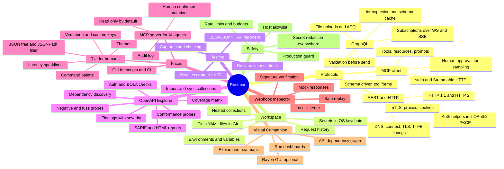
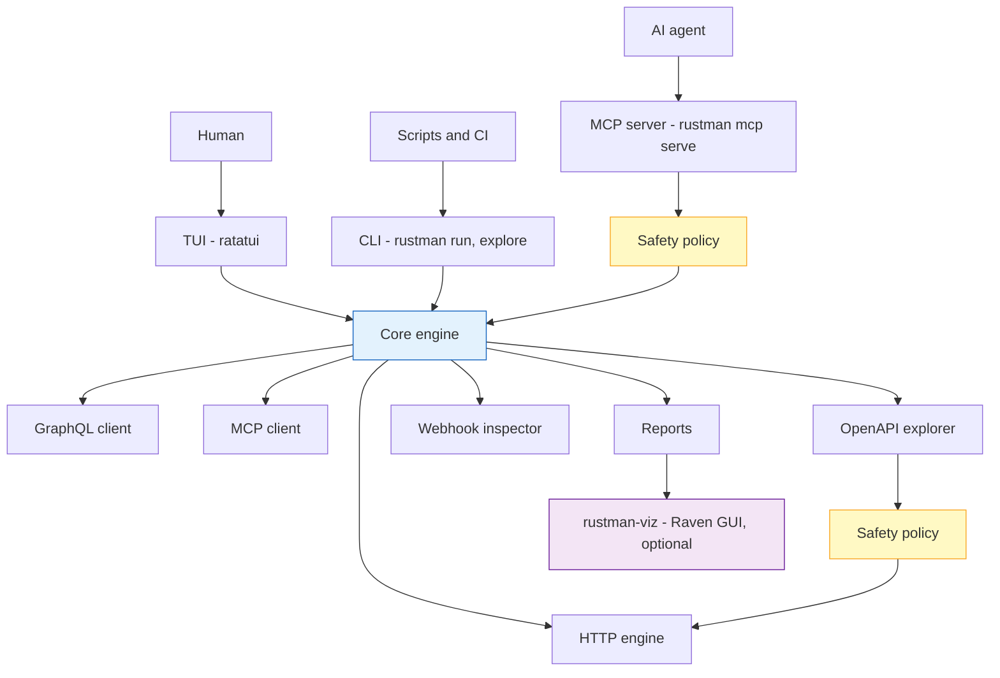

# Rustman

> A fast, local-first API workbench for the terminal. It speaks **REST, GraphQL and MCP**, it can **test a backend on its own from an OpenAPI spec**, and **AI agents can drive it over MCP**. Written entirely in Rust.

> [!NOTE]
> **Status: design phase.** Rustman is fully specified but not implemented yet. Everything below describes the planned behavior, as defined by the [OpenSpec](https://github.com/Fission-AI/OpenSpec) changes in [`openspec/`](openspec/). Commands and file formats come from those specs and may still change before v1.

---

## Why Rustman?

| Pain with today's API clients | Rustman's answer |
|---|---|
| Heavy Electron apps idling at hundreds of MB of RAM | One native Rust binary that runs in your terminal |
| Mandatory accounts and cloud sync for private requests | **Local-first.** Requests are plain YAML files you commit to Git. No accounts, no telemetry. |
| One tool for REST, another for GraphQL, another for MCP | **One workbench for all three protocols** |
| Tests written by hand, endpoint by endpoint | **Point it at an OpenAPI spec** and it plans and runs a full test campaign |
| AI agents can't use your API client | **Built-in MCP server.** Agents use the same engine you do, under the same safety rules. |
| Great GUI or great automation, rarely both | **Three front-ends, one engine:** a TUI for humans, a CLI for CI, MCP for agents. An optional GUI shows charts. |

---

## Feature map



---

## What you can do with Rustman

### 1. Explore and debug APIs in a terminal UI

Open a workspace, then pick a request from the collection tree, edit it, and send it with `Ctrl+Enter`. Sends never freeze the UI, and `Esc` cancels one that's in flight. Responses open as a collapsible JSON tree with a JSONPath filter. You also get a timing waterfall (DNS, connect, TLS, time to first byte, download) and a latency sparkline built from that request's history.

```bash
rustman            # open the TUI in the current workspace
```

| Key | Action |
|---|---|
| `Ctrl+Enter` / `Ctrl+R` | Send request |
| `Esc` / `Ctrl+C` | Cancel the request in flight |
| `Ctrl+S` | Save request file |
| `Ctrl+P` | Fuzzy command palette |
| `Ctrl+B` | Toggle sidebar |
| `Ctrl+T` / `Ctrl+W` | New tab / close tab |
| `Alt+E` | Switch environment |
| `Alt+R` | Reveal secrets (session only, shows a `SECRETS VISIBLE` badge) |
| `Ctrl+E` | Edit body in `$EDITOR` |
| `v` | Open the current response or run in the visual companion |
| `?` | Help |
| `Ctrl+Q` | Quit |

There's an optional **vim mode** (`--vim` or `keymap = "vim"`), and you can remap any key in `~/.config/rustman/keybindings.toml`. Themes: dark, light and high-contrast. Truecolor falls back to 256 colors, and `NO_COLOR` is respected. The layout adapts down to 80x24.

### 2. Keep your API collections in Git

A workspace is a folder with a `rustman.toml` file. Each request is one readable YAML file:

```yaml
# users/create-user.rman.yaml
version: 1
kind: http
name: Create user
method: POST
url: "{{base_url}}/users"
headers:
  - { name: Authorization, value: "Bearer {{token}}" }
body:
  type: json
  content: { name: "Ana", role: "admin" }
assertions:
  - status: 201
  - json: { path: "$.id", exists: true }
  - latency: { total_lt: 500 }
captures:
  - { var: user_id, from: json, path: "$.id" }
```

- **Environments** live in `environments/<name>.yaml`. Variables resolve at send time, plus dynamic values such as `{{$uuid}}`, `{{$timestamp}}` and `{{$randomInt}}`.
- **Secrets** stay in your OS keychain, or in a git-ignored `.rustman/secrets.yaml`. They're never written to request files, history, reports or logs, and they're redacted wherever they could leak.
- Saving a file you didn't change produces no diff, so code review stays clean.

### 3. Run API tests in CI

```bash
rustman run . --env staging --reporter pretty --reporter junit:out/junit.xml
rustman send users/create-user.rman.yaml --var name=Bob
rustman import curl < request.sh          # turn a curl command into a request file
rustman export curl users/create-user     # and back
```

Exit codes are stable across every command, so they're easy to script against:

| Code | Meaning |
|---|---|
| `0` | Everything passed |
| `1` | A check failed (an assertion, or a finding at or above `--fail-on`) |
| `2` | Usage or configuration error |
| `3` | A request errored (network, TLS, timeout, unresolved variable) |
| `4` | Refused by the safety policy |
| `130` | Interrupted |

### 4. Let Rustman test your backend from an OpenAPI spec

Give Rustman an OpenAPI 3.0/3.1 document and a target. It works out how your endpoints depend on each other (for example, `POST /users` returns an id that `GET /users/{id}` needs). It then generates probes and runs them:

| Probe family | What it checks |
|---|---|
| Conformance | Status codes and response bodies match the spec's schemas |
| Negative input | Missing required fields, wrong types, values outside the allowed range or enum, oversized payloads |
| Auth enforcement | Missing or invalid credentials get `401`/`403` |
| BOLA / IDOR | With two identities, user A can't read user B's resources |
| Undocumented behavior | Status codes and methods the spec doesn't declare |
| Error leakage | Stack traces, SQL errors, missing security headers |
| Lifecycle chains | Create, read, update, delete flows, cleaning up afterwards |
| Fuzzing | Property-based inputs with a reproducible seed |

```bash
rustman import openapi https://api.example.com/openapi.json      # generate a collection
rustman explore plan --spec api.yaml --target https://staging.example.com   # dry run: list the probes
rustman explore run  --spec api.yaml --target https://staging.example.com \
  --report html=out/report.html --report sarif=out/report.sarif
rustman explore export <id> --findings all --into regressions/  # turn findings into request files
rustman report diff old.json new.json                           # what got better or worse
```

**Safe by default.** Explorations are **read-only** (`GET`, `HEAD`, `OPTIONS`) unless you pass `--allow-mutations`. `DELETE` also needs `--allow-destructive`. Only the target host is contacted, at a default of 10 req/s with probe and time budgets. A production target only runs if you repeat its host name, and `DELETE` is never allowed against production.

Each run produces findings with a severity (critical to info), the exact exchange as evidence, a curl command to reproduce it, and a coverage matrix of operations × status codes.

### 5. Query and explore GraphQL APIs

```bash
rustman graphql introspect https://api.example.com/graphql --out schema.graphql
rustman graphql query users.rman.yaml --var limit=10
```

Rustman caches the schema, validates each operation against it before sending (with exact error locations), and gives the TUI autocompletion and a schema browser. Subscriptions work over `graphql-transport-ws` or SSE. File uploads, automatic persisted queries, and responses with partial data plus errors are all handled.

### 6. Inspect and test MCP servers

Connect to any Model Context Protocol server over stdio or Streamable HTTP. Older HTTP+SSE servers are handled too:

```bash
rustman mcp-client tools files
rustman mcp-client call files read --arg path=README.md
rustman mcp-client resources files --read file:///notes.md
```

You get forms generated from each tool's input schema, output validation, a stream of server notifications, progress and cancellation, and OAuth 2.1 for remote servers. If a server asks the client to run an LLM prompt (sampling) or to ask the user something (elicitation), Rustman **always asks you first**, and headless runs refuse. You can save tool calls as `kind: mcp` request files with assertions and replay them in CI.

### 7. Give your AI agent an API workbench

Rustman runs as an MCP server, so agents such as Claude Code can list requests, send them, run collections, import OpenAPI specs and run explorations. They use the same engine and the same safety rules as a human:

```bash
claude mcp add rustman -- rustman mcp serve      # stdio
rustman mcp serve --http 127.0.0.1:8765          # Streamable HTTP (bearer token required)
```

```toml
# rustman.toml — agent permissions come only from this file, never from CLI flags
[agent]
allow_mutations = false        # read-only by default
allow_destructive = false
require_confirmation = true    # a human approves every change through MCP elicitation
allowed_hosts = ["staging.example.com"]
```

Tool results are size-capped, paginated and redacted. Every agent action is written to an append-only audit log in `.rustman/audit/`. Long explorations run as background jobs that report progress and can be cancelled.

### 8. Catch and replay webhooks locally

```bash
rustman webhook listen                 # 127.0.0.1:9090 by default
```

The listener accepts any method on any path and stores bodies byte for byte. You can set mock responses per path (status, headers, body, delay) and verify GitHub, Stripe or generic HMAC signatures. Replay a captured webhook to another URL with transport headers stripped so the replay is clean. Size limits and a bounded buffer keep memory in check, and `--json` output pipes into other tools.

### 9. See it visually when the terminal isn't enough

With the optional **`rustman-viz`** companion, built on the [Raven](https://github.com/oscar-soirey/Raven) GUI library, run and exploration results open as native dashboards:

- **Run dashboard:** summary tiles, a donut of status codes, latency plot and histogram, per-request sparklines
- **Exploration dashboard:** heatmap of operations × status codes, coverage gauges, findings table
- **API graph:** a node graph of operations and their data dependencies
- **Large responses:** JSON arrays as sortable tables, plus a read-only JSON viewer

```bash
rustman run api/ --viz                 # stream a live dashboard while the run executes
rustman viz reports/run.json           # open a saved report
```

The companion is **optional and read-only**: it never sends requests. It needs Vulkan (MoltenVK on macOS), so it's built separately (cargo feature `raven`). If it isn't installed, Rustman offers the self-contained HTML report instead.

---

## Architecture



| Crate | Responsibility |
|---|---|
| `rustman-core` | Workspace, environments, variables, secrets, request model, safety policy |
| `rustman-http` | HTTP execution on hyper and rustls, timings, auth, curl import and export |
| `rustman-graphql` | GraphQL execution, introspection, validation, subscriptions |
| `rustman-mcp` | MCP client and server, built on the official `rmcp` SDK |
| `rustman-explore` | OpenAPI parsing, probe generation, exploration engine, findings |
| `rustman-report` | Reports in `rustman.report/v1` format: JSON, JUnit, TAP, Markdown, HTML, SARIF |
| `rustman-webhook` | Webhook inspector, built on hyper |
| `rustman-tui` | Terminal UI |
| `rustman-cli` | The `rustman` binary |
| `rustman-viz` | Optional Raven GUI companion, separate binary |

**Build principles**
- The default binary builds with plain `cargo build`: no OpenSSL, SQLite, GPU or CMake to install.
- Linux, macOS and Windows are first-class.
- No UI code in the engine crates.
- Every bug fix ships with a regression test.

---

## Roadmap

| Milestone | Changes | You get |
|---|---|---|
| **M1 - Usable** | `bootstrap-core-engine`, `add-terminal-ui` | REST client with workspace, environments, TUI and CLI runner |
| **M2 - Multi-protocol** | `add-graphql-client`, `add-mcp-client`, `add-webhook-inspector` | GraphQL, MCP client, webhooks |
| **M3 - Autonomous** | `add-openapi-explorer`, `add-agent-mcp-server` | OpenAPI exploration, agent interface |
| **M4 - Visual** | `add-raven-visualizer` | Raven dashboards |

The order, the glossary and the cross-cutting contracts are in [`openspec/ROADMAP.md`](openspec/ROADMAP.md).

---

## Contributing

Rustman is built **spec-first** with [OpenSpec](https://github.com/Fission-AI/OpenSpec):

```bash
npm install -g @fission-ai/openspec@latest
openspec list                      # changes in flight
openspec show bootstrap-core-engine
openspec validate --all --strict   # CI runs this on every PR
```

1. Pick the next change in roadmap order, or propose a new one in `openspec/changes/<id>/`.
2. Implement it against its `tasks.md`. Each task says how to verify it.
3. Archive the change when it's done (`openspec archive <id>`). Its specs then become the living docs in `openspec/specs/`.

## License

To be decided (likely dual MIT OR Apache-2.0, matching the Rust ecosystem).
