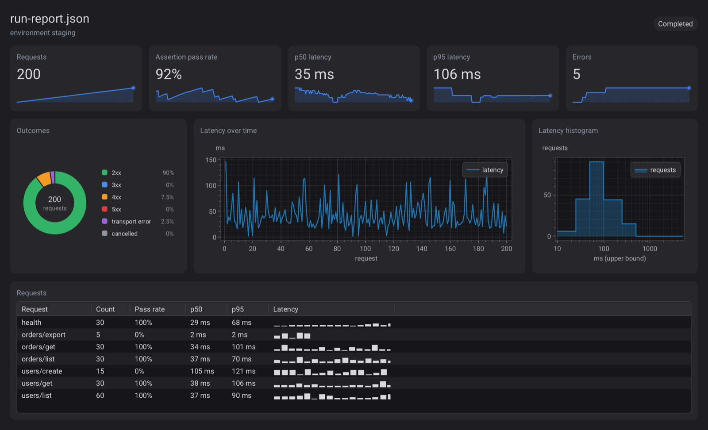
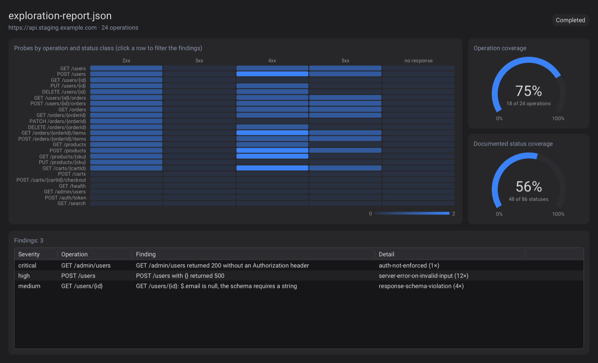
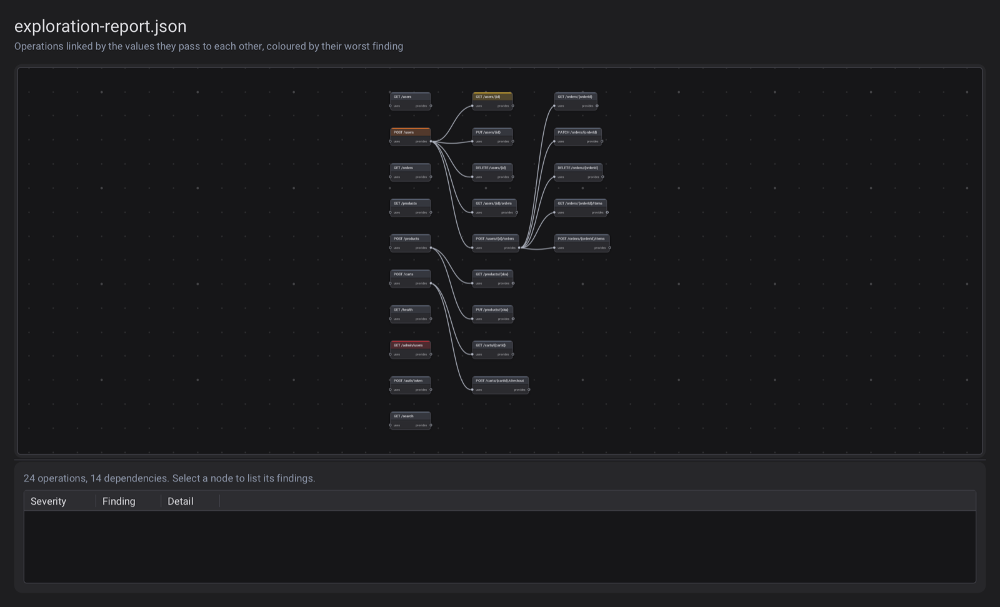
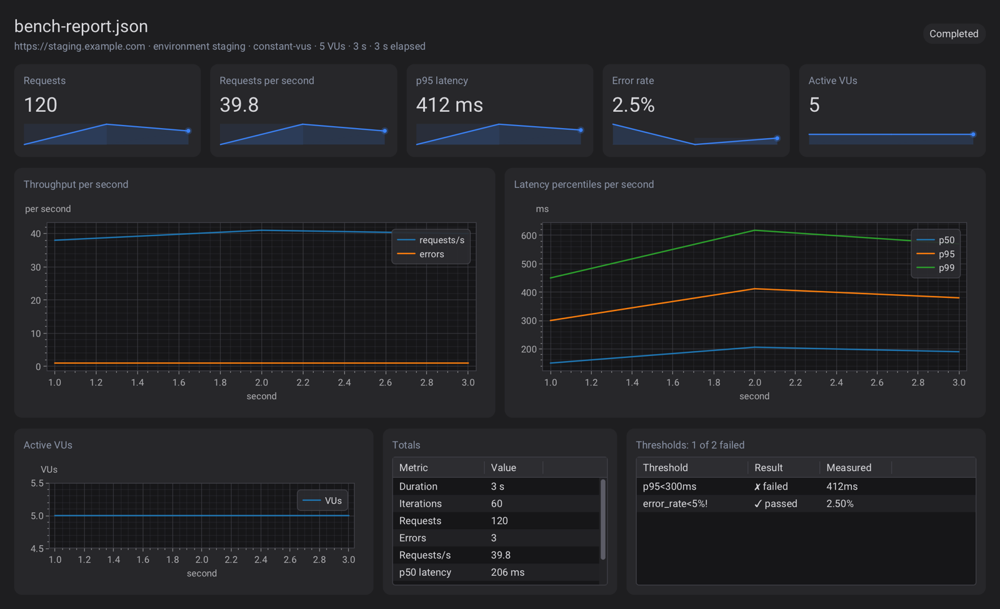
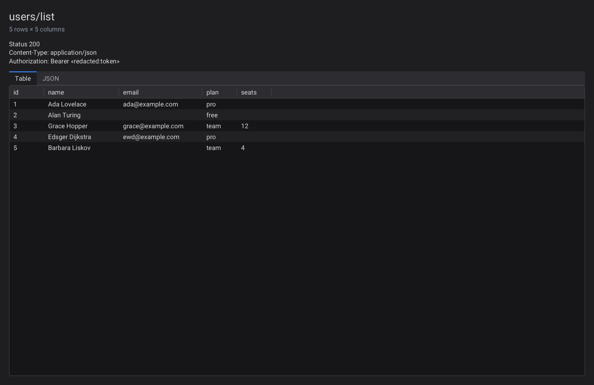

# Viz companion (`rustman-viz`)

`rustman-viz` is an optional graphical companion that shows runs, explorations, load tests and large responses as native dashboards. It is a separate program built on the [Raven](https://github.com/oscar-soirey/Raven) GUI library (Apache-2.0). `rustman` works the same without it: nothing in `rustman` links Raven or needs a GPU, and when the companion is missing every command still runs. How `rustman` finds and starts it is described in [Viz companion](cli.md#viz-companion), and the messages they exchange in [the viz protocol](viz-protocol.md).

The companion is **read-only**. It sends no request, runs no request file and writes no workspace file. What it shows was redacted by `rustman` before it was sent: secrets appear as `«redacted:name»`, and the companion has no way to reveal them.

## Opening it

```sh
rustman run api/ --viz                       # live run dashboard while the run executes
rustman explore run --spec api.yaml --target https://staging.example.com --viz
rustman viz out/run.json                     # a saved run report
rustman viz .rustman/explorations/<id>/report.json              # exploration dashboard
rustman viz .rustman/explorations/<id>/report.json --view graph # API graph
rustman bench checkout/ --target https://staging.example.com --viz   # live bench dashboard
rustman viz out/bench.json                   # a saved bench report (--report json=out/bench.json)
```

In the TUI, `v` in the response viewer opens the current response in the inspector.

## Views

### Run dashboard



- **KPI tiles:** requests, assertion pass rate, p50 and p95 latency, and errors (requests that got no response). Each tile has a sparkline of its history. While a run is in progress the requests tile reads `done / planned`.
- **Outcomes:** a donut of 2xx, 3xx, 4xx, 5xx, transport errors and cancelled requests.
- **Latency over time** and a **latency histogram** with a logarithmic axis. Each histogram bucket is labelled by its upper bound in milliseconds.
- **Requests:** one row per request file, with its count, pass rate, p50, p95 and latency trend.

The state badge reads `Running`, `Completed`, `Aborted` or, if `rustman` went away before the end, `Producer disconnected`. The dashboard keeps the last state it received. Live dashboards are redrawn at most 10 times a second. When updates arrive faster than that, progress updates are merged, but findings and final summaries are always kept.

### Exploration dashboard



- **Heatmap:** one row per operation and one column per status class (2xx, 3xx, 4xx, 5xx, no response). During a live exploration each cell counts probes. For a saved report it counts the documented statuses that were observed, because a report keeps no status for each probe.
- **Gauges:** operation coverage (operations that answered at least once) and documented-status coverage.
- **Findings:** sorted by severity, then by operation. Click a heatmap row to show only that operation's findings, and click it again to show them all.

### API graph



There is one node per operation and one link per data dependency, meaning a value from one operation's response used as a parameter of another (for example, the `id` that `POST /users` returns feeds `GET /users/{id}`). Producers sit on the left. Each node is coloured by its worst finding: red for critical, orange for high, yellow for medium, blue for low, and grey for none. Select a node to list its findings. The links come from the `dependencies` field of exploration reports, which `rustman explore run` writes from version 0.1.

### Bench dashboard



`rustman bench --viz` opens it and sends one update per second; `rustman viz <report.json>` opens a saved bench report in it.

- **KPI tiles:** requests, requests per second, p95 latency, error rate and active VUs, each with a sparkline of its last 120 seconds. While the bench runs, requests per second and p95 are those of the last second; once it ends, those of the whole bench.
- **Throughput per second** (requests per second and errors), **latency percentiles per second** (p50, p95 and p99) and **active VUs**, one point per second.
- **Totals:** duration, iterations, requests, errors, requests per second and the p50, p95 and p99 latency of the whole bench. While it runs, the duration, requests and errors so far.
- **Thresholds:** each threshold as written, whether it passed, and the measured value. They are known when the bench ends.

The subtitle shows the target, environment and load profile (for a saved report), the time elapsed and, while a bench with a fixed duration runs, the time left. The state badge reads `Running`, `Completed`, `Aborted (threshold)` or `Aborted (interrupted)`, or `Producer disconnected` when `rustman` went away before the end. A slow companion misses some seconds rather than slowing the bench, so a live plot may have gaps; the totals come from the end of the bench and are exact.

### Response inspector



A JSON array becomes a table. The array is either the top level of the body or the one a JSONPath selector picks. The columns are the union of the keys of the first 1,000 elements, and a missing key leaves an empty cell. Rows are read on demand, so arrays of millions of rows scroll smoothly. Click a column header to sort: numbers sort by value and missing values sort last. The **JSON** tab shows the body as read-only, highlighted text, limited to its first MiB. A body without an array shows only the JSON view.

Bodies larger than 16 MiB arrive as a temporary file (`blob_ref`) that `rustman` deletes once the companion exits. The whole body is parsed into memory: a 200 MiB array takes a few seconds and a few GiB of memory.

## Installing

Prebuilt `rustman-viz` packages are not published yet. Until they are, build the companion from source with the Raven library:

1. Download the Raven 0.3.0 package for your platform from the [releases](https://github.com/oscar-soirey/Raven/releases/tag/v0.3.0), for example `raven-macos-universal-static.tar.gz`, `raven-linux-x64-static.tar.gz` or `raven-windows-msvc-x64-static.zip`. Check it against `SHA256SUMS.txt`, then extract it.
2. Build the companion and put it next to `rustman` or on `PATH`:

   ```sh
   cd crates/rustman-viz
   RAVEN_LIB_DIR=/path/to/raven/lib RAVEN_STATIC=1 cargo build --release --features raven
   cp target/release/rustman-viz ~/.local/bin/    # or anywhere on PATH
   ```

   Without `RAVEN_LIB_DIR`, the build stops and says where to get the library. Without `--features raven`, no `rustman-viz` binary is built.
3. Check it: `rustman-viz --protocol-check` prints `rustman-viz/1`.

Graphics by platform:

| Platform | Backend | Needs |
|----------|---------|-------|
| macOS | Metal | nothing (MoltenVK is not needed with Raven 0.3) |
| Linux | Vulkan | a Vulkan driver and loader (`libvulkan1`), X11 or Wayland |
| Windows | Vulkan | a GPU driver with Vulkan (current NVIDIA, AMD and Intel drivers include it) |

The companion lives in `crates/rustman-viz`, in a workspace of its own. Building `rustman` never fetches or builds Raven.

## Troubleshooting

| What you see | Why | What to do |
|--------------|-----|------------|
| `Viz companion not found` | No `rustman-viz` on `PATH`, next to `rustman`, or in `RUSTMAN_VIZ` | Install it (above), or set `RUSTMAN_VIZ=/path/to/rustman-viz` |
| `RUSTMAN_VIZ=… is not an executable file` | The override points at nothing usable | Fix or unset `RUSTMAN_VIZ` |
| `Viz companion speaks rustman-viz/2, rustman needs rustman-viz/1` | The companion and `rustman` come from different releases | Upgrade the older one |
| `Graphics unavailable (Vulkan)` | The companion exited with code 3: no GPU backend could start (no Vulkan driver, a remote session or a VM) | Install the GPU driver, or use `rustman report render <report> --format html` |
| `Viz companion exited` | The window was closed, or the companion crashed | The run goes on. The companion's stderr is in `.rustman/viz.log` |
| `Viz companion stopped reading for 5 s; detached from it` | The companion froze | The run goes on without visuals |

Exit codes of `rustman-viz`: `0` when its windows are closed or `--protocol-check` succeeds, `2` for bad arguments, `3` when graphics cannot start (after an `error` line `vulkan_unavailable`), and anything else for a crash.

## Development

- `RUSTMAN_VIZ_DEV_LAYOUTS=<dir>` makes the companion read the window layouts from `<dir>` instead of the copies built into the binary. The originals are in `crates/rustman-viz/layouts/`.
- `RUSTMAN_VIZ_HEADLESS=1` runs it with no window system and no GPU (Raven's null backend). The integration tests use it.
- `scripts/check_viz_e2e.py <rustman> <rustman-viz>` checks `rustman run --viz` end to end with the real companion drawing a real window: it runs the demo collection (`examples/demo`) against the demo API, records what crosses the pipe, and asserts the handshake, the full event stream (with the API token never sent) and the companion's clean exit after it captured the run dashboard. CI runs it on Linux under Xvfb with Mesa's software Vulkan driver (lavapipe), in the `viz-e2e` job.
- `rustman-viz --capture <dir>` waits for its input to end, then saves every window as a PNG and exits. The screenshots on this page were made with `--capture` from `crates/rustman-viz/tests/fixtures`, which hold sample data rather than a real API.
- All `unsafe` code is in `src/raven_adapter/`. The rest of the crate denies `unsafe_code`, and the view models in `src/model/` are tested without Raven.
